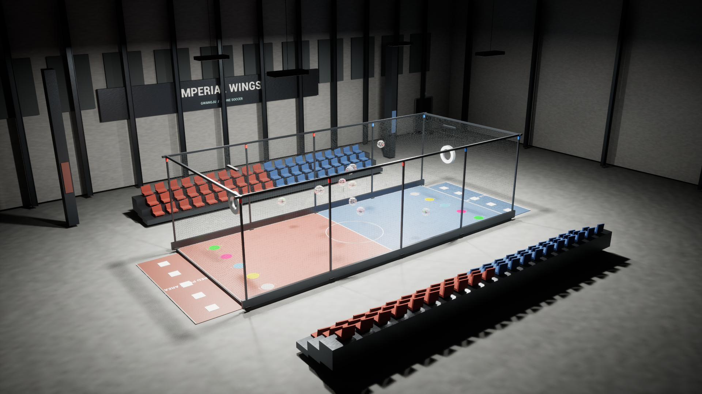
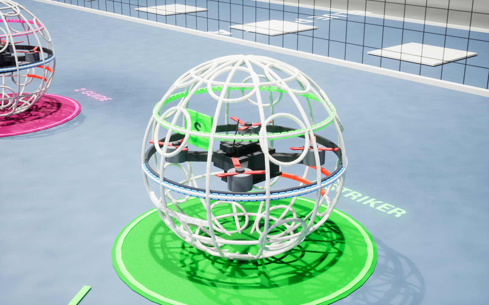

# Imperial Wings Drone Soccer Simulator

## Windows 실행파일 다운로드 — v0.6.0

[Windows x64 실행용 ZIP](https://github.com/sun475300-sudo/Drone-Soccer-Simulator/releases/download/v0.6.0/ImperialWings-Windows-v0.6.0-r2.zip)을 **전체 압축 해제**한 뒤 `ImperialWingsLauncher.exe`를 실행합니다. Unreal Engine·Python·Git을 설치할 필요가 없습니다. GitHub의 Source code ZIP은 개발 소스이며 실행용 ZIP과 다릅니다.

첫 실행의 조종기 화면에서 **NEXT DEVICE → STICK SETUP / MODE 2 → CONFIRM & SAVE → ENABLE RADIO** 순서로 실제 장치를 보정합니다. 스로틀 최저에서 패널을 닫고 Space로 ARM합니다. 보정값은 각 Windows 사용자의 `%LOCALAPPDATA%\ImperialWingsSimulator\Saved`에 저장하고 다른 사람의 보정값을 배포하지 않습니다.

[다른 PC에서 실행·조종기 설정](docs/PORTABLE_QUICK_START.ko.md)을 확인하세요. Windows 10/11 x64와 DirectX12 / Shader Model6 GPU가 필요합니다. 필수 Visual C++ 설치 파일과 자율 훈련용 독립 실행 환경을 포함합니다. 개발 PC에서 설치 도구 경로를 제거하고 한글·공백 경로로 옮긴 새 사용자 데이터 환경을 검사했으며, 실제 다른 PC 전체에서의 비행을 인증한 것은 아닙니다.


Unreal Engine 5.8 기반 Windows 드론축구 시뮬레이터입니다. 기본 시점은 **경기장 밖 조종자 위치에서 기체를 보는 LOS(육안) 조종**입니다. FIDA Class40의 경기장·기체 규격과 5대5 경기 흐름, RadioMaster Boxer용 USB 보정 UI, 실제 SDACS APF를 사용하는 자율 훈련을 함께 개발합니다.

기체는 네 모터의 개별 힘과 회전 모멘트, 중력·항력·Chaos 접촉으로 움직입니다. 정상 비행에서 위치를 강제로 갱신하지 않으며 초기화에서만 물리 위치를 되돌립니다. 실기체와 일치하도록 실측 보정된 제품은 아닙니다.

## 개발 소스 빌드 환경과 설치

필요 환경은 Windows, Unreal Engine 5.8, Visual Studio 2022 C++ 빌드 도구와 Windows SDK, Python 3.12, Git입니다. 실제 검증 PC는 UE 5.8.3 / RTX 5070 Ti / RAM 32GB입니다.

```powershell
git clone https://github.com/sun475300-sudo/Drone-Soccer-Simulator.git
Set-Location Drone-Soccer-Simulator

# 아래 두 설치 경로를 자신의 PC에 맞춥니다.
$EngineRoot = 'C:\Program Files\Epic Games\UE_5.8'
$PythonExe = 'C:\Path\To\Python312\python.exe'
$SdacsRoot = [IO.Path]::GetFullPath((Join-Path $PWD '..\swarm-drone-atc'))

.\Scripts\Configure-Environment.ps1 -EngineRoot $EngineRoot -Python $PythonExe -RepoRoot $SdacsRoot
.\Scripts\Setup-Bridge.ps1
.\Scripts\Build.ps1 -Package
.\Scripts\Launch.ps1
```

`Setup-Bridge.ps1`는 외부 SDACS 저장소가 없으면 복제하고 프로젝트 `.venv`에 최소 의존성을 설치합니다. `Build.ps1`은 C++ 에디터 모듈을 빌드하며 맵이 없거나 `-GenerateContent`를 지정한 경우에만 자체 콘텐츠를 생성합니다. PC별 경로는 Git에서 제외한 `SimulatorEnvironment.local.json`에 저장하며 환경변수와 명시적 인자로 재지정할 수 있습니다.

배포 실행 파일을 만들려면 `Build.ps1`에 `-Package`를 추가합니다. 개발 패키지는 `dist/Integrated/Windows/`에 생성됩니다. 실행 배포 ZIP은 `pip install -r Bridge/requirements-portable-build.txt` 후 `Scripts/Build-Portable.ps1 -OutputDirectory <새 폴더>`로 별도 작성합니다. 실행 파일 주변의 Engine·프로젝트 폴더도 함께 필요합니다. 빌드된 PC에서는 `ImperialWings.cmd`로 브리지와 게임을 시작할 수 있습니다. 저장소에는 엔진·패키지 실행 파일·가상환경을 포함하지 않습니다.

## LOS 조종과 화면

기본 조종자 카메라는 선택한 팀의 자기 진영 바깥 `x=±9.5m, z=1.7m`에 있습니다. 기체를 선택하면 그 팀·역할에 대응하는 조종석으로 이동합니다.

| 조작 | 동작 |
|---|---|
| 1 | 기본 LOS 조종자 시점 |
| 우클릭 드래그 / 마우스 휠 | LOS 시선 회전 / 시야각 확대·축소 |
| 2 / 3 | 외부 추적 관찰 / 경기장 전체 관찰 |
| Tab / 오른쪽 기체 목록 | 조종할 기체 선택 |
| Space | 낮은 스로틀에서 ARM / DISARM |
| ↑ / ↓ | 키보드 스로틀 증가·감소 |
| W / S, A / D, Q / E | Pitch, Roll, Yaw |
| Backspace / Home | 선택 기체 초기화 / 전체 초기화 |
| C / RADIO USB | USB 장치·축 보정 패널 |
| F10 | 넓은 LOS 화면 / 관제 패널 전환 |
| F5 / EXPORT CSV | 실제 물리 상태를 CSV로 저장 |
| F6 | 실제 비행·입력 기록 시작/종료 |
| F8 | 최저 스로틀에서 일치하는 저장 조종기 연결/해제 |
| GRAPHICS | Balanced/High/Cinematic 화질 선택·사용자별 저장 |

수동 비행은 모든 기체에 **ANGLE 모드**를 적용합니다. Roll/Pitch는 최대35°의 목표 기울기를 명령하며 스틱이나 키를 놓으면 수평으로 복원합니다. Yaw는 각속도,고도는 스로틀로 직접 조절합니다. 기본 조종 시점은 경기장 밖 조종자의 육안 위치에 고정합니다.

RadioMaster Boxer는 USB HID 장치를 선택한 뒤 축 배정·최대/최소 범위·중립·반전과 최저 스로틀을 확인해야 합니다. 기본값은 키보드이며 미보정 상태에서 USB 조종으로 임의 ARM하지 않습니다. 실제 Radiomaster Boxer Joystick 연결과 게임의 라이브 축 표시는 확인했습니다. 네 스틱 전 범위·방향 보정과 USB 수동 비행은 별도 현장 검증 항목입니다. [USB 설정](docs/BOXER_SETUP.md)을 참고합니다.

**STICK SETUP / MODE 2**는 오른쪽 Roll/Pitch,왼쪽 Yaw/Throttle을 한 단계씩 실제로 움직여 축과 방향을 찾는 안내 화면입니다. 각 단계에서 Enter로 시작·끝값 확인을 할 수 있고,중립·최저 스로틀 확인 후 검토 화면에서 따로 저장합니다. 설정 중에는 비행 단축키가 차단되며 취소하면 이전 프로필이 유지됩니다. 이 기능을 추가한 것과 실물 스틱 보정·USB 비행을 완료한 것은 구분합니다.

## 경기와 자율 훈련

기본 규정 프로필은 [FIDA Class40 제5차 개정, 2026-01-01 시행](https://fidasystem.com/rules.html)입니다. 권장 경기장 **16×7×4.5m**, 보호구 외경 **40cm**, 골대 내경 **60cm**이며 골대는 양 끝에서 1.5m 안쪽, 중심 높이 3.0m에 배치합니다. 현재 기체 질량 0.9kg은 규정 상한 1.1kg 이내의 시뮬레이터 설정값입니다. STRIKER V3의 실측 질량으로 주장하지 않습니다.

팀당 5명 중 스트라이커만 득점합니다. 기체 전체가 상대 골대를 앞에서 뒤로 통과해야 하며 팀 오프사이드는 활성 기체 전원이 자기 진영으로 복귀해야 해제됩니다. 경기 코어는 10초 준비, 180초 세트, 300초 정비와 최대 3세트·2선승을 관리합니다. 준비·정비·종료 단계의 ARM은 제한합니다. 경기를 시작하는 동작이 자동 이륙을 뜻하지 않습니다.

**공식 경기 모드는 수동 조종**, SDACS 자동 비행은 **Practice의 훈련 보조**로 구분합니다. AUTO FLEET/Enter는 자율 훈련, HOLD/H는 현 위치 유지, RETURN/R은 홈 패드 귀환·착륙, MANUAL은 선택 기체를 수동으로 전환하고 DISARM합니다. 완전한 인간 심판 판정, 공격수 승계, 실제 페널티 경기·연장·승부치기·VAR은 구현 범위 밖입니다. 규격과 구현 한계는 [규정 근거](docs/rules-sources-2026.md)에 정리했습니다.

## 기체 모델과 실험 물리

외형은 제조사 자료를 참고해 직접 작성한 **STRIKER V3 참고형 절차적 모델**입니다. 흰색 40cm 보호구의 둥근 셀, 검은 X 프레임·적도 링, 3엽 프로펠러와 하부 배터리·배선·체결 요소를 표현합니다. 제조사 메시·사진·설명서·로고를 복제한 공식 제품 모델이 아니며 제작 치수와 비행 특성을 정확히 재현했다고 주장하지 않습니다. [공식 자료와 관찰·가정 구분](docs/model-reference.md)을 참고합니다.

고급 물리 확장은 실험 단계입니다. 엔진 독립 모델과 Unreal 통합에서 다루는 항목은 다음과 같습니다.

- 비선형 PWM-추력, 모터 응답·포화, 회전자 동력 추정
- 배터리 소모·내부저항에 따른 전압 강하·출력 제한
- 부품 질량 배분에 따른 무게중심·관성 텐서, 회전자 자이로 토크
- 상대 풍속 기반 항력, 하향류, 지면·천장·벽 근접 보정
- IMU 바이어스·잡음·지연과 PID 적분 포화 방지
- 제한된 스프링·댐퍼 접촉 및 네트·보호구 변형 근사

계수는 조정 가능한 가정값입니다. CFD, 모터 벤치 측정, 실기체 IMU·추력·충돌 측정을 대체하지 않습니다. 각 모델의 존재와 실제 게임에서 검증된 통합 범위는 구별하며 최신 결과는 [검증 기록](docs/verification.md)에 남깁니다.

## 실제 SDACS 연동

[기반 저장소](https://github.com/sun475300-sudo/swarm-drone-atc)의 실제 `simulation/apf_engine/apf.py`를 외부 작업 사본에서 import합니다. Unreal이 위치·속도를 미터 단위로 10Hz 전송하고 upstream `batch_compute_forces`·`force_to_velocity`가 짧은 목표점 생성에 참여합니다. Unreal이 물리 상태의 원본이며 브리지는 합성 기체 위치를 보내지 않습니다.

현재 확인한 upstream 커밋은 `1e9d826265069696d7e415c7778d17483d7a8580`입니다. 개발 실행의 `http://127.0.0.1:8767/health`에 실제 origin·커밋·로드한 파일·SHA-256이 표시됩니다. 실행 중 데이터 연결은 localhost이며 외부 통신은 소스 복제·의존성 설치에 사용합니다. 연결이 끊기면 자율 임무를 로컬 위치 유지로 전환합니다. [연동 계약](docs/sdacs-integration.md)과 [외부 권리 고지](THIRD_PARTY_NOTICES.md)를 참고합니다.

## 실제 실행과 검증



2026-10-26 R4의 Windows 에디터 빌드·패키징·실행을 확인했습니다. 실제 키보드/마우스 조작 **96개 항목 모두 통과**: 수동 ARM·상승·높은 스로틀 ARM 거부,USB 미보정 활성화 거부,10대 AUTO/HOLD/RETURN·착륙,세 시점,기체 선택·CSV·초기화 흐름을 검사했습니다. 귀환·전원 DISARM은11.82초였습니다.

고정 게임 계산 간격30/60/120Hz에서 실제 Chaos 호버·수평 이동·바닥/벽·5m/s 네트 충돌·스트라이커 골대 통과와 오프사이드도 모두 통과했습니다. 마지막 목표 오차는0.456/0.284/0.202cm,네트 모델 최대 처짐은5.30/6.72/7.47cm였습니다. 독립 검사는 규정51개·USB 보정159개·물리83개·실제 APF HTTP8개가 통과했습니다. 이 결과가 실기체 물리 정확도나 모든 경기 상황을 인증하는 것은 아닙니다.

1920×1080 경기장 장면의 실제 패키지 렌더 기록은 **평균88.16FPS**,RTX5070Ti입니다. 오프스크린 렌더 중 측정했으며 RTX5060이나 USB 입력 지연의 측정값은 아닙니다. 로그와 이전 중단 기록을 포함한 [검증 문서](docs/verification.md)를 참고합니다.



역할별 시작 패드·색상·라벨·중앙선 방향 화살표와,흰색 전방 한 줄·빨간색 후방 두 줄 LED를 추가했습니다. 역할 색상은 FIDA 기준이며 방향등과 포지션 좌우 순서는 훈련용 설계 선택입니다. [시작 위치·LED 출처와 설계](docs/position-and-led-design.md),[물리 모델별 구현 범위](docs/physics-models.md)에 근거와 한계를 정리했습니다.

```powershell
.\Tests\run-rules-tests.ps1
.\Tests\run-radio-tests.ps1
.\Tests\run-physics-tests.ps1
$env:SDACS_REPO = $SdacsRoot
.\.venv\Scripts\python.exe .\Bridge\test_sdacs_bridge.py
.\Tests\run-runtime-tests.ps1 -Packaged

# 현재 연결된 실제 Windows 조이스틱을 읽기만 합니다.
& $PythonExe .\Tests\radio_probe.py --duration 20 --output .\Saved\radio-observation.json
```

화면·CSV·실행 로그·USB 보정 데이터·다운로드 원문은 로컬 `Saved/`에 보관합니다. 공개 소스에는 자체 제작 자산·렌더와 재현 가능한 시험을 포함합니다. Boxer의 실제 채널 보정·USB 비행,독립 고정 물리 스레드 PID,실기체 계수 측정,보호구/네트 정밀 연성체·CFD와 전체 심판 운영 기능은 후속 항목입니다.
공식 경기 영상 참고 링크와 이번 실행 창에서 확인한 역할별 패드·후미 LED는 [경기 영상 참고·게임 대조 기록](docs/match-video-references.md)에 정리했습니다. 자동 재생 제한으로 영상의 장면별 분석은 미완료이며,현재 구현의 규정 근거와 구분했습니다.

R5에서는 Mode 2 안내 보정을 추가하고 새 Windows 패키지에서 **화면 조작119개·보정 수학159개 전부 통과**했습니다. 실제 Boxer를 선택해 라이브 수집·정지 입력 완료 거부·취소 시 프로필 보존을 확인했습니다. 실물의 단계별 스틱 보정과 USB 수동 비행은 남아 있습니다. [실제 보정 화면](docs/images/radio-mode2-setup.png)과 [R5 검증 기록](docs/verification.md)을 참고합니다.

R6 / v0.4.0에서는 **10대 전부 ANGLE**로 전환했습니다. 실제 Chaos에서20/30/60/120/240FPS 조건의 초기 기울기 복원·스틱 해제 후 수평 복원을 모두 통과했습니다. 이 시험은 명시적 비USB 입력 fixture와 고도 보상을 사용해 자세 제어를 분리하며 실물 조종기 비행 성적으로 주장하지 않습니다. 실제 화면의69개 검사에서10대의 시작점·홈·렌더 패드·초기 방향과 각 LOS 조종자 위치도 확인했습니다.

실물 Boxer의 Roll=X,Pitch=Y,Yaw=V,Throttle=Z 배정과 실제6,454샘플의 끝값·중립·최저 스로틀 보정을 저장했습니다. 미완료 스틱 범위가 마지막 중립에서 거부되던 안내 흐름은 시작 중립의 양쪽 범위를 먼저 확인하도록 수정했고 보정 수학161개가 통과했습니다. USB 활성화·최저 스로틀 ARM까지 실제 확인했으며 연속 USB 비행은 포커스 전환으로 완료하지 못했습니다.

화면·CSV·물리 결과에는 프로젝트 버전,빌드 시각,소스 커밋과 빌드 입력SHA-256을 기록합니다. 실행 스크립트는 현재 빌드 입력과 실행 파일의 불일치를 표시합니다. 검증한 R6 스냅샷은 `01fa67e132697ad826c30bec585ca45242e3c9df97be4347689efd63046237c9`입니다. 빌드 뒤 작업 폴더에 추가된 그래픽 효과 소스는 이 스냅샷의 검사와 구분합니다. [버전별 검증](docs/verification.md),[개발 순서](docs/development-roadmap.md)를 참고합니다.

포터블 배포 실행기는 실제 MIT APF 소스·검증 해시를 포함한 독립 Windows 런타임을 사용합니다. 설치 Python/Git을 찾지 않으며 자동으로 선택한 localhost 포트를 사용하고 게임 종료 시 해당 프로세스를 종료합니다. 원본 작업 저장소를 수정하지 않습니다.
