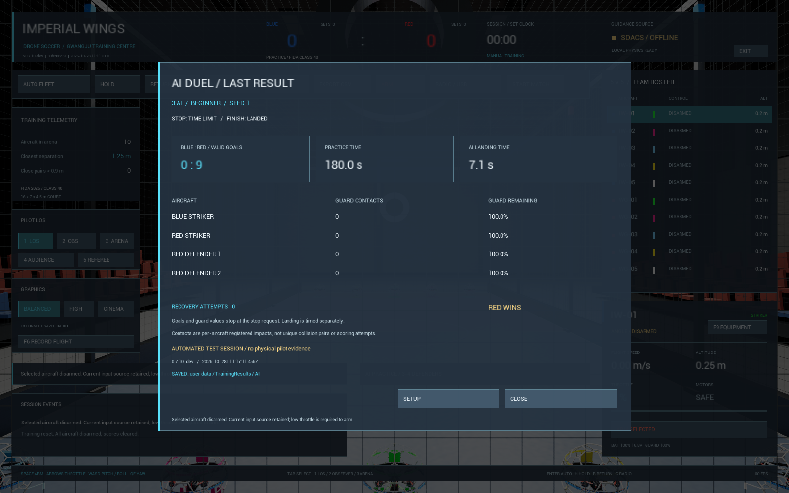

# 싱글플레이 AI 대전 — v0.7.10-dev

**파란 스트라이커 1대 대 빨간 AI 총 3대 또는 4대**의 로컬 훈련 대전이다.
빨간 팀은 스트라이커 1대와 수비 2대/3대로 구성된다. 공식 FIDA 5대5 세트 경기가 아니며,
기존 정규 경기의 수동 조종·자동 ARM 금지 조건은 유지한다.

## 실행 순서

1. 모든 기체를 착륙·DISARM한 뒤 **AI PRACTICE → DUEL / 3 MINUTES**를 선택한다.
2. AI 총 대수와 초급·중급·고급, 수비 배치 시드를 선택한다.
   **DEFENCE PRACTICE**로 바꾸면 기존의 사람 공격수 대 AI 수비 전용 연습이다.
3. **START**를 누르면 패드와 점수를 초기화하고 빨간 AI만 이륙한다.
   대전 시간은 이때부터 3분이며 별도의 준비 카운트다운은 아직 없다.
   파란 스트라이커는 사용자가 조종기를 활성화하고 낮은 스로틀에서 직접 ARM한다.
4. LOS·ANGLE로 공격한다. 득점한 뒤에는 기체 전체가 자기 진영으로 돌아와야 다시 득점할 수 있다.
   빨간 팀도 활성 참가자 전원이 돌아와야 한다. 비참가 기체는 복귀 판정에서 제외한다.
5. 3분 종료 시 두 팀의 점수를 고정하고 AI를 수직 착륙시킨다.
   **사용자의 파란 기체는 직접 착륙한다.** 경기 종료가 사용자 모터를 자동 정지시키지는 않는다.
6. **LAST RESULT**에서 양 팀 점수와 승리/무승부, 시간·보호구 상태·복구 횟수를 확인한다.
   정상 시간 종료가 아닌 **STOP AI**, 초기화, 기체 복구 실패 등은 `INTERRUPTED`로 표시한다.
   메뉴를 열면 수동 기체가 DISARM되므로 먼저 착륙한다.
7. 종료된 점수는 이후 비행으로 바뀌지 않는다. 새 훈련은 **RESET** 또는 새 **START**로 시작한다.

## 실제 공격 동작과 판정

공격 AI는 수직 이륙 → 상대 골대 앞 접근 → 저속 정렬 → 골대 통과 → 골대 옆으로 빠져나오기 →
자기 진영 복귀를 반복한다. 목표 위치를 기존 자세 제어기에 전달하며 이동은 모터 힘과 강체 물리로
계산한다. 골대 진입의 목표점 이동 속도는 초급0.35·중급0.45·고급0.55m/s다.
이는 실제 속력을 강제하는 값이 아니며 수비 반응/속도는 기존 난이도 설정을 사용한다.

AI가 골대 뒤에 도착했다는 이유로 득점을 추가하지 않는다. 기존 규칙 엔진이 실제 기체의
전체 통과·방향·개구부 여유·역할·오프사이드를 검사한다. 목표를 놓치거나 통과에 실패해도
복귀 후 다음 공격을 시도한다. 공격 경로와 실제 위치/공격 단계/복귀 횟수는 검사 기록 및 F6에 남는다.

비참가 기체는 패드에서 DISARM 상태로 남으며 득점·팀 복귀 판정에 참가하지 않는다.
F6의 `opponents`는 전체 AI 수, `defenders`는 수비 수로 구분한다.

공격수에도 정체 감지·최대2회 연속 우회·뒤집힘/모터 해제 종료를 적용한다.
수비와 달리 양쪽 진영에 걸친 우회 범위를 사용한다. 자동으로 다른 기체를 플레이어에게 넘기거나
플레이어를 자동 ARM하지 않는다. 경기 중 공식 경기·다른 자율 임무로 덮어쓰기도 차단한다.

## 결과 파일 호환성

새 결과는 schema2에 `session_mode`(`defence`/`duel`), `opponents`(AI 총 대수),
`goals`(파랑), `opponent_goals`(빨강)를 기록한다. 승패는 두 점수와 종료 이유에서 계산한다.
schema1의 `defenders` 기록은 기존 수비 연습으로 읽으며 원본 파일을 변환하거나 덮어쓰지 않는다.
새 기록에서도 세션별 원자적 저장, 저장 실패 재시도, 명시적 버리기와 손상 기록 건너뛰기를 유지한다.
로컬 파일은 인증된 온라인 대회 기록이 아니다.

## 남은 범위

현재는 사람이 공격수 한 대로 공격과 방어를 겸하는 비대칭 훈련이다. 사람 팀에 AI 동료를 배정하는
혼합 팀전, 5대5 협력 전략, 시야 가림·센서 지연을 포함한 판단, 사람 대상 난이도 평가는 후속이다.
AI는 게임 안의 위치와 골대 상태를 읽는다. 경로 시드가 같아도 물리 궤적이나 득점 수까지 같음을
보장하지 않으며, 무인 시험의 득점 수를 실제 사용자 상대 성능으로 해석하지 않는다.
시작 알림·마지막10초 화면 효과·음성 알림은 별도 계획으로 유지한다.

[검증 기록](verification.md#ai-duel-0710) · [수비 연습](ai-practice-2026-10-28.md) ·
[충돌/정체 처리](ai-recovery-2026-10-28.md) · [전체 계획](master-development-plan.md#ai).
