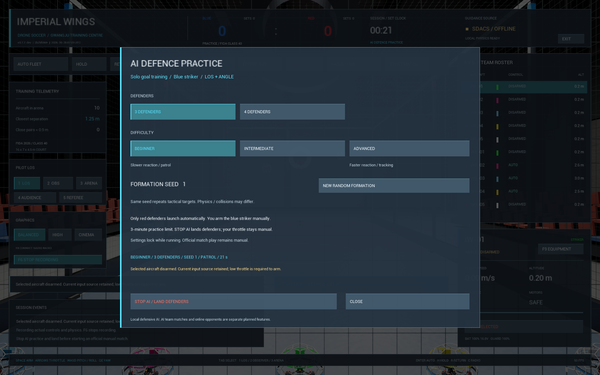

# AI 수비 연습 — v0.7.7-dev

`codex/ai-training`의 첫 AI 연습 구현이다. 사람은 **파란 스트라이커1대**를 LOS·ANGLE로 조종하고,
빨간 수비 기체3대 또는4대가 실제 모터 힘·충돌 물리로 비행한다. 공식 수동 경기와 분리했으며
AI 팀 대전·자동 공격수·승패 결과 화면은 아직 없다. 공개 실행 ZIP v0.7.4-r2에는 이 기능이 없다.

## 사용 순서

1. Practice에서 모든 기체를 착륙·DISARM한다. 관객/심판 시점에서는 파일럿 시점으로 돌아온다.
2. 화면 아래 **AI PRACTICE / 3-4 DEFENDERS**를 연다. 메뉴를 열면 선택한 수동 기체는 DISARM된다.
3. **3 DEFENDERS / 4 DEFENDERS**와 **BEGINNER / INTERMEDIATE / ADVANCED**를 선택한다.
4. 새 배치가 필요하면 **NEW RANDOM FORMATION**을 누른다. 같은 난수 번호를 유지하면
   같은 전술 목표 순서를 다시 사용한다. 번호 직접 입력·설정의 재실행 저장은 후속이다.
5. **START PRACTICE / RESET PADS & SCORE**를 누르면 출발 패드·점수가 초기화되고
   빨간 수비만 이륙한다. 처음4초는 수직 이륙 목표를 사용하고 이후 수비 구역으로 이동한다.
6. 메뉴가 닫힌 뒤, 파란 스트라이커는 최저 스로틀에서 직접 ARM한다. 기존 키보드/보정된 USB 입력을 사용한다.
   같은 골을 반복하려면 기존 규칙에 따라 스트라이커가 자기 진영으로 완전히 복귀해야 한다.
7. **AI PRACTICE / SETTINGS & STOP → STOP AI / LAND DEFENDERS**로 수비를 수직 착륙시킨다.
   파란 기체는 직접 착륙해야 한다. 메뉴를 여는 동작은 수동 기체를 DISARM하므로 먼저 내려놓는다.
8. AI는180초 후 자동으로 착륙 절차에 들어간다. 접촉 때문에30초 이상 착륙하지 못하면 상태 안내를 표시한다.
   **RESET**은 모든 기체를 즉시 초기 패드로 되돌리는 명시적 초기화다.

비행 중 설정 변경·AI 기체 선택·기존 AUTO/HOLD로 소유권 변경·공식 START MATCH 전환을 차단한다.
RETURN은 AI 착륙 요청으로 처리한다. 상단 RETURN 버튼은 설정 메뉴를 열지 않고 수비만 착륙시킬 때 사용할 수 있다. AI 종료 후 공식 경기를 시작해도 자동 ARM하지 않는다.
사용하지 않는 기체는 출발 패드에 DISARM 상태로 남는다.

## 난이도와 실제 구현 범위

| 난이도 | 전술 갱신 간격 | 목표 이동속도 상한 | 추가 반응 |
|---|---|---|---|
| 초급 | 1.8초 | 0.45m/s | 작은 좌우 추적 영향 |
| 중급 | 0.9초 | 0.75m/s | 추적 영향 증가 |
| 고급 | 0.4초 | 1.05m/s | 현재 속도로 최대0.3초 앞의 좌우 위치 예측 |

이는 **목표점**의 제한이며 실제 기체 속도를 강제로 설정하는 값이 아니다. 실제 몸체에는 기존
자율 자세 제어·모터 지연·전력 한도·항력·충돌이 적용된다. 층을 나눈 수비, 좌우 순찰,
스트라이커 추적 중 하나를 난수로 선택하고 각 기체의 좌우 구역을 유지한다.
초기 배치는 기존 규정 패드이며 공중 수비 목표와 전술을 무작위화한다.

현재 상대 위치·속도는 게임 상태를 읽는다. 시야 가림·센서 지연·학습형 AI·역할 교대·협력 공격은 미구현이다.
목표 구역 간격은 충돌 회피 보장이 아니다. 플레이어가 충돌하면 물리적으로 밀리고,
심한 접촉/교착·기체가 뒤집힌 상태에서의 회복은 추가 시험이 필요하다.
난이도의 체감·성공률은 사람의 조종 평가를 아직 받지 않았다.

이 AI 전술은 로컬에서 동작하며 SDACS HTTP 응답이 없어도 실행한다. 기존 AUTO FLEET의
실제 SDACS APF 출처와 구분한다. 같은 난수는 전술 목표를 재현하며 서로 다른 PC/FPS의
Chaos 충돌 궤적까지 동일하다고 보장하지 않는다.

## 기록과 검증

F6 비행 기록에는 AI 활성/착륙 상태·대수·난이도·난수·전술 갱신 횟수·경과 시간과
각 기체의 실제 위치/목표점이 들어간다. 개인 조종기 보정은 변경하지 않는다.

[검증 결과·배포 확인](verification.md#r11-ai-practice) ·
[기계 판독 가능한 근거](verification/ai-practice-2026-10-28.json) ·
[전체 계획의 남은 AI 대전·결과 분석](master-development-plan.md#ai).

다음 작업은 실조종으로 수비 강도를 평가하고, 교착 복구·유효 득점 기반 결과 요약·AI 대전 상태를 추가하는 것이다.
탑건 S코스·닉네임/ID/국적·기록방은 별도 미완료 단계로 유지한다.
