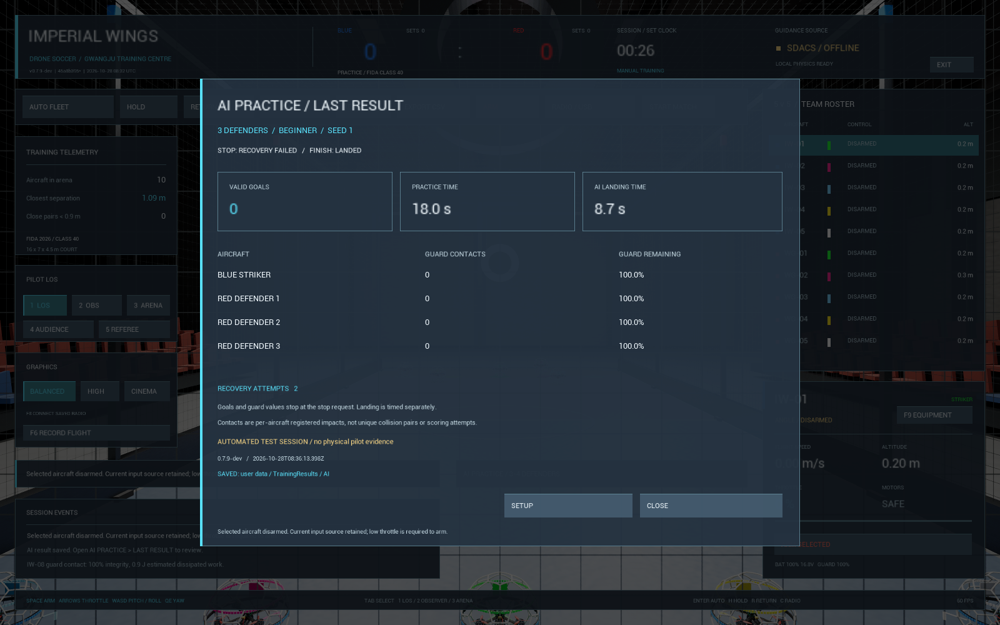

# AI 수비의 충돌·정체 처리 — v0.7.9-dev

AI 수비 연습에서 충돌 후 멈춘 기체를 감지하고 짧은 우회 목표를 제시한다.
기존 자세 제어와 모터 힘으로 이동하며 질량·추력 한도를 높이지 않는다.
일반적인 가드 충돌은 기존 비행 제어가 자세와 위치를 회복한다.
`codex/ai-training` 개발 기능이며 공개 다운로드 v0.7.4-r2에는 포함되지 않는다.

## 연습 중 동작

1. **AI PRACTICE**에서 수비 3대/4대와 난이도를 선택하고 시작한다.
   파란 스트라이커는 계속 직접 LOS·ANGLE로 조종한다.
2. 수비가 목표에 도달하지 못한 채 정체되면 알림과 `RECOVERING` 수가 표시된다.
   잠깐 뒤·옆·위로 이동한 뒤 기존 수비 목표를 다시 따른다.
3. 연속 두 차례 우회 후에도 정체되면 연습을 끝내고 수비팀에 착륙을 지시한다.
   바닥에서 뒤집힌 수비 또는 자동 조종이 해제된 수비를 발견해도 연습을 종료한다.
   파란 기체는 자동 착륙하거나 자동 ARM하지 않으므로 직접 착륙한다.
4. 수비 착륙 후 **LAST RESULT**에서 종료 이유와 `RECOVERY ATTEMPTS`를 확인한다.
   기체가 계속 물리적으로 걸려 있으면 착륙 완료로 처리하지 않는다.
   30초가 지나면 정체 안내가 나오며, **RESET**을 선택하면 초기화로 중단한 기록을 남긴다.

| 화면의 종료 이유 | 의미 |
|---|---|
| RECOVERY FAILED | 우회 한도 소진 또는 장시간 큰 기울기로 비행 지속 불가 |
| DEFENDER OVERTURNED | 바닥 근처에서 크게 뒤집힘. 해당 수비의 모터 정지 후 나머지 수비 착륙 |
| DEFENDER DISABLED | 수비의 ARM 또는 자동 조종이 해제됨. 자동으로 다시 켜지 않음 |
| FINISH: LANDED | 모든 수비가 실제로 바닥 근처에 내려와 느려지고 모터가 꺼진 뒤에만 표시 |

`RECOVERY ATTEMPTS`는 해당 세션의 모든 수비가 우회를 시작한 횟수 합계다.
연속 실패 한도는 수비별 2회이며, 목표 부근을 1초 유지하면 연속 실패 수가 초기화된다.
따라서 정상 복구 후 다시 막힌 세션이나 여러 수비의 합계는 2회를 넘을 수 있다.
이 값과 종료 이유는 기존 결과 파일에 저장되고 재실행 시 복원된다.
v0.7.8의 결과 파일처럼 이 값이 없으면 0으로 읽으며 원본을 수정하지 않는다.

## 현재 판정 값

실측으로 확정된 기체 특성이 아닌 시뮬레이터의 초기 제어 설정이다.

| 항목 | 값 |
|---|---|
| 정체 관찰 시작 | 이륙 후 6초부터 |
| 정체 조건 | 목표 오차 0.75m 초과, 2초 동안 기준 위치에서 이동 0.22m 이하 |
| 우회 목표 | X축 −0.9m, 중앙 쪽 옆으로 0.45m, 위로 0.45m; 수비 공간 안으로 제한 |
| 우회 시간 | 최대 3초; 0.6초 이후 목표 0.3m 이내이고 충분히 수평이면 조기 종료 |
| 바닥 뒤집힘 | 중심 높이 0.34m 미만, 기체 위쪽 방향의 수직 성분 0.35 미만을 0.4초 유지 |
| 공중 자세 실패 | 이륙 6초 이후 위쪽 방향의 수직 성분 0.2 미만을 2초 유지 |
| 착륙 완료 | 모든 수비의 중심 높이 0.32m 미만, 속력 0.35m/s 미만, 모터 정지 |

## 검증과 남은 범위

검사는 실제 두 강체의 충돌, 임시 물리 제약으로 움직임을 막았다 풀기, 계속 막기,
뒤집힌 초기 조건, 공중 모터 해제를 각각 구분한다. 뒤집힘·충돌의 재현 위치 설정은
명시적인 시험 초기 조건이며, 운영 코드의 복구 방법에 순간이동을 사용하지 않는다.
자세 복원·착륙·종료 결과는 실제 언리얼 강체 값을 읽어 확인한다.

이번 점검에서 자동 조종이 꺼진 기체를 공중에서도 착륙 검사에서 제외하던 조건을 수정했다.
이제 그 기체도 높이와 속력을 검사하므로, 모터가 꺼졌다는 이유만으로 착륙 성공을 기록하지 않는다.

네트에 실제 보호구가 걸리는 정밀 변형/얽힘, 복잡한 다중 장애물 경로 재계획,
기체를 뒤집어 세우는 터틀 모드, AI 팀 대전, 실물 USB 조종·다른 PC 검증은 별도 작업이다.
물리 제약 시험의 성공을 실제 네트 탈출 성능이나 사람 대상 난이도 검증으로 확대하지 않는다.

[검사 결과와 실행본](verification.md#ai-recovery-079) · [기본 AI 연습](ai-practice-2026-10-28.md) ·
[결과 저장 안내](ai-results-2026-10-28.md).
