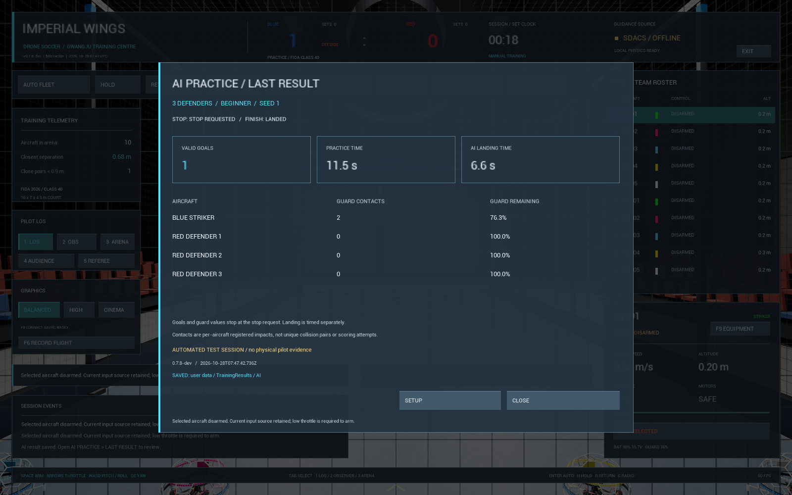

# AI 연습 결과와 저장 — v0.7.8-dev

AI 수비 연습에 **LAST RESULT** 화면과 세션별 JSON 저장을 추가했다.
사람·AI 팀의 승패를 판단하는 대전 결과 화면은 아직 아니다.
공개 다운로드 v0.7.4-r2에는 이 기능이 없으며 `codex/ai-training`의 개발 기능이다.

## 확인 방법

1. [AI 수비 연습](ai-practice-2026-10-28.md)을 시작한다. 파란 스트라이커는 직접 조종한다.
2. 연습이 끝나면 **RETURN** 또는 AI 메뉴의 **STOP AI**로 수비를 착륙시킨다.
   연습180초 제한도 같은 착륙 절차를 사용한다. 파란 기체는 직접 착륙한다.
3. **AI PRACTICE → LAST RESULT**에서 마지막 결과를 확인한다.
   메뉴를 열면 수동 기체가 DISARM되므로 먼저 착륙한다. 결과 화면을 자동으로 띄워 조종을 중단시키지는 않는다.
4. **SETUP**은 연습 설정으로, **CLOSE**는 기존 화면으로 돌아간다.
   설정을 다시 시작해도 앞서 저장한 결과 파일은 삭제하지 않는다.

## 표시 값의 의미

| 값 | 의미 |
|---|---|
| VALID GOALS | 종료 요청까지 기존 경기 규칙이 승인한 파란 스트라이커의 득점 |
| PRACTICE TIME | 시작부터 종료 요청까지의 게임 시간. 초기 수비 이륙 시간도 포함 |
| AI LANDING TIME | 종료 요청 이후 수비가 내려와 모터를 끄거나 중단될 때까지의 게임 시간 |
| GUARD CONTACTS | 기체별 보호구 모델에 등록된 충격 횟수. 두 기체의 같은 충돌이 각각 집계될 수 있음 |
| GUARD REMAINING | 종료 요청 시점의 실험적 보호구 잔여 내구도. 실물 재질 파손 수명으로 해석하지 않음 |
| STOP | 수동 종료 요청,180초 제한,초기화,앱 종료 등 연습을 끝낸 이유 |
| FINISH | 수비 착륙 완료 또는 착륙 완료 전 초기화/앱 종료 |

**득점·보호구 값은 종료 요청 시점에 고정**한다. 이후 착륙 중 충돌과 득점은 연습 성과에 추가하지 않는다.
초기화·앱 종료는 `reset`·`application_exit`로 남기며 착륙 완료로 표시하지 않는다.
게임 시간과 실제 벽시계 시간은 서로 다를 수 있다. 시도 횟수·성공률·승패·온라인 순위를 추정하지 않는다.
자동 검사 기록은 화면과 파일에 `AUTOMATED TEST SESSION` / `test_session=true`로 구분한다.

## 저장과 복구

파일은 사용자 데이터 폴더의 **`TrainingResults\AI\<시각>-<세션ID>.json`**에 저장한다.
기본 위치는 `%LOCALAPPDATA%\ImperialWingsSimulator\Saved` 아래다.
새 파일을 완전히 쓴 뒤 게시하며, 같은 세션 재저장은 중복 파일을 만들지 않는다.
기존 세션·조종기 보정 파일은 덮어쓰지 않는다.

저장에 실패하면 결과를 메모리에 유지하고 **NOT SAVED**를 표시한다.
**RETRY SAVE**로 원래 세션 ID의 저장을 다시 시도한다. 이 상태에서 새 연습을 시작해 결과가
사라지지 않도록 막는다. 저장하지 않고 계속하려면 **DISCARD UNSAVED**를 직접 누른다.
이 버튼은 메모리에만 남은 결과를 버리며 이미 저장한 파일을 삭제하지 않는다.
앱을 종료하기 전 저장을 다시 시도해야 하며, 충돌/강제 종료 직전의 미저장 메모리 복구는 보장하지 않는다.

다음 실행에서는 최신 파일부터 최대100개 후보를 검사해 첫 정상 기록을 복원한다.
지원하지 않는 버전·잘못된 자료형/범위·중복 기체·손상 JSON은 건너뛰고 원본은 보존한다.
유효 기록이 없으면 결과가 없는 상태로 시작한다. 로컬 파일은 사용자가 수정할 수 있으며
온라인 대회 기록으로 인증한 데이터가 아니다. 전체 이력 탐색·비교 그래프·결과 CSV는 후속이다.

[검사 근거와 배포 확인](verification.md#ai-results-078) ·
[원시 검사 항목](verification/ai-results-2026-10-28.json).
