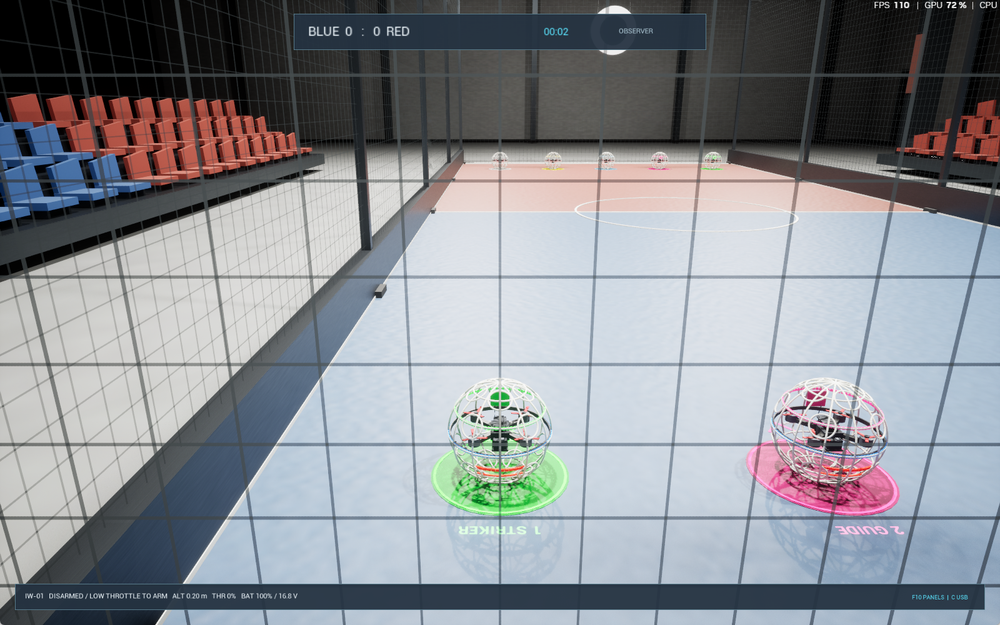
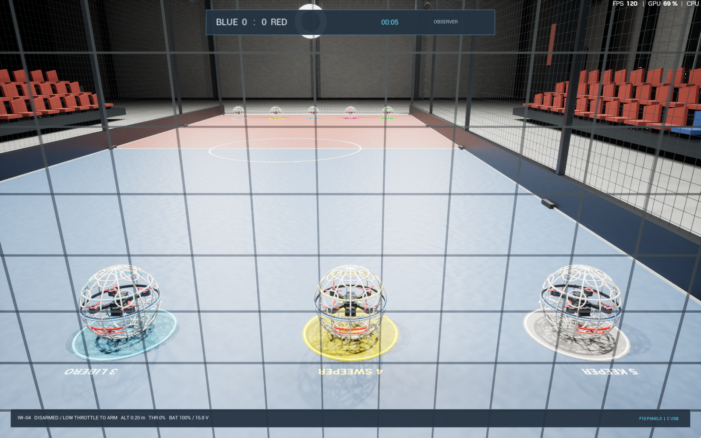

# 공식 경기 영상 참고 목록과 시뮬레이터 대조

확인일:2026-10-26 KST. 기본 구현의 규정 프로필은 FIDA2026 Class40이다. 영상은 경기 분위기·LOS 위치·팀 식별·공수 움직임을 비교할 참고 자료이며,영상의 원근이나 플레이 속도로 실측 치수·추력·반발계수를 만들어 내지 않는다.

## 우선 참고: FIDA Class40

아래 URL과 제목은 [FIDA 공식2025 전주 월드컵 페이지](https://www.dronesoccer.org/worldcup)의 Highlight Videos 항목과 공개 HTML에서 대조했다. 이 페이지는 FIDA 공식 채널로도 연결된다.

| 영상 | 활용할 항목 | 현재 열람 상태 |
|---|---|---|
| [Class40 결승: 한국–중국](https://www.youtube.com/watch?v=quodd4wmBqs) | 40cm급5v5의 주요 영상 참고 | 공식 연결·제목 확인,전체 재생/타임코드 분석 미완료 |
| [World Cup Highlight Part1](https://www.youtube.com/watch?v=l8cWcfGvyqI) | 경기장·기체 식별성·중계 시점 비교 후보 | 공식 연결 확인,장면 분석 미완료 |
| [World Cup Highlight Part2](https://www.youtube.com/watch?v=91oSxIB1Cag) | 골대 주변 공방·접촉·복귀 동작 비교 후보 | 공식 연결 확인,장면 분석 미완료 |
| [World Cup Highlight Part3](https://www.youtube.com/watch?v=H3sF_ZZH0HU) | 팀 식별·관중석/조명 분위기 비교 후보 | 공식 연결 확인,장면 분석 미완료 |

공식 목록에는 Class20 결승도 있으나 현재40cm 기체 물리를 단순 축소하는 근거로 쓰지 않는다. 2025년 영상과2026년 시행 규정이 다를 수 있으므로 경기장·골대 치수는 [현행 규정 근거](rules-sources-2026.md)를 따른다.

비교 자료로 [FAI 공식2025 상하이 대회 보도](https://www.fai.org/news/china-wins-first-ever-fai-world-drone-soccer-championships-shanghai-0)에서 연결하는 [공식 중계 재생 목록](https://youtube.com/playlist?list=PLyXQtZ_gjrxDK_6U2JK1KTlFKIckwwJ7i)도 찾았다. FAI와FIDA의 경기장/역할/세부 규정은 혼합하지 않는다.

## 이번에 게임 안에서 직접 확인한 것

영상의 시청 기록과 아래 실제 Unreal 관찰 결과를 구분한다. 실제 패키지 창을 조작해 모든 기체를 DISARM하고,외부 관찰 시점에서1–5번을 차례로 선택해 화면을 저장·확인했다.

| 항목 | 실제 게임 확인 | 근거 |
|---|---|---|
| 시작 위치 | 끝선에서1.5m 안쪽5개 색상 패드,역할명·출발 방향,두 팀 거울 배치 | 현재 FIDA 시작선 규정+훈련용 좌우 순서 |
| 역할 구분 | 스트라이커 초록/가이드 분홍/리베로 하늘/스위퍼 노랑/키퍼 흰색 | 현재 FIDA 역할 색상,5개 실시간 화면 확인 |
| 팀 구분 | 적도 띠의 파랑/빨강 | 현재 FIDA 팀 LED 규정 |
| 방향 구분 | 앞 흰색 한 줄,뒤 빨강 두 줄. 외부 관찰에서 후미 두 줄 확인 | Betaflight 방향 팔레트 참고,자체 배치 |
| 조종 시점 | 기본은 경기장 밖 LOS,점검만 외부 관찰 카메라 사용 | 실제 입력/CSV 시점 검증 |
| 득점·복귀 | 스트라이커 완전 통과·역방향 거부·팀 후퇴 해제 | FIDA 규정 코어51개 검사,실제 물리 골대 시험 |
| 접촉 | 기체/바닥/골대 재질·네트 탄성/감쇠 | 현재 실험 모델과 실제 충돌 시험;영상 보정값 아님 |

## 재생 제한과 후속 대조

이번 환경에서 YouTube 직접 열기는 웹 도구의 throttling 응답을 받았고,별도 브라우저 자동 재생 실행은 자동 승인 검토에서 `blocked by policy`로 거절됐다. 이를 우회하지 않았다. 공식 링크와 공개 설명은 확인했지만 특정 시각의 장면·비행 궤적·접촉 반동을 시청했다고 기록하지 않는다. 위 구현 사항은 규정·제조사 공개 자료·현재 게임 확인에 근거한다.

향후 실제 재생이 가능한 환경에서 발사 대기·일제 이륙·첫 골·공격 팀 후퇴·수비 접촉의 타임코드를 기록하고,관찰된 동작과 현재 모델을 대조한다. 영상을 그대로 배포 에셋에 복제하지 않고 공식 링크만 제공한다. 물리 계수는 별도의 실기체 측정으로 보정한다.
