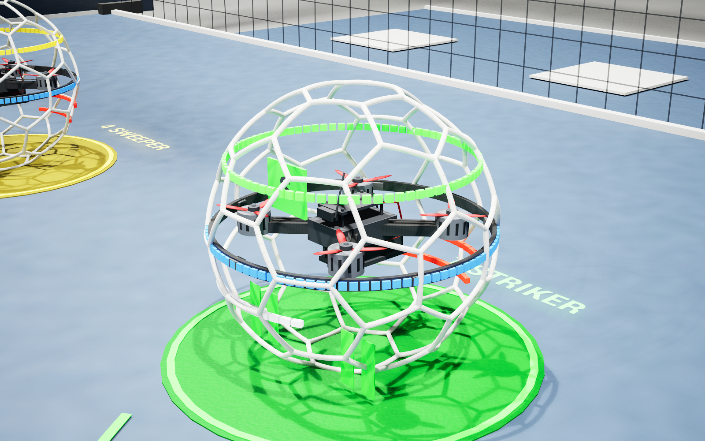

# Imperial Wings v0.6.0 — 다른 PC 실행·조종기 설정·기체 업데이트

[Windows 실행 ZIP 다운로드](https://github.com/sun475300-sudo/Drone-Soccer-Simulator/releases/download/v0.6.0/ImperialWings-Windows-v0.6.0-r2.zip)

ZIP 전체를 압축 해제한 뒤 `ImperialWingsLauncher.exe`를 실행하세요. Unreal Engine·Python·Git을 설치할 필요가 없습니다. Windows10/11 x64와DirectX12/ShaderModel6 GPU가 필요하며,VC실행 구성요소가 없으면 포함한 설치 파일을 안내합니다.

첫 실행에서 NEXT DEVICE로 조종기를 고르고 STICK SETUP / MODE2 안내에 따라 실제 축을 보정하세요. CONFIRM & SAVE → 최저 스로틀에서 ENABLE RADIO → 패널닫기 → Space ARM입니다. 설정은 각 Windows 사용자의 AppData에 저장됩니다. 다른 사람의 Boxer 보정은 배포하지 않습니다.

자체42셀40cm 보호구·둥근 접합부·모터 냉각 슬롯·체결/전원 배선을 추가했습니다. 10대 모두 ANGLE이며 기본 시점은 경기장 밖 LOS입니다. HELSEL 공식 CAD를 복제한 모델이나 실기체 동역학 인증 제품은 아닙니다.

실제 ZIP 압축 해제·한글/공백 경로·개발 도구 제거 환경15개 검사,실물 Boxer 프로필 저장/재로딩,10대 모델/위치/LED/질량,30/60/120FPS 물리와20/30/60/120/240FPS ANGLE 검사를 통과했습니다. 실제 다른 물리PC의 모든 HID/GPU 조합과 완전한 USB 이륙·착륙은 현장 검증이 남아 있습니다.

[시작 안내](../PORTABLE_QUICK_START.ko.md) · [검증 기록과 제한](../verification.md)

실행 ZIP SHA-256: `0b79c05dda4b7b85ce776a11b383ec917a9df4b39b584e229b8aa2dfbbd71296`.
