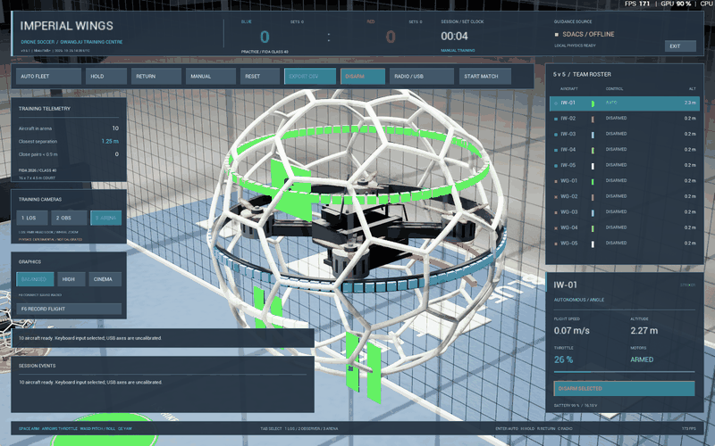

# v0.6.1 — 조종기 간소 설정·실행 GIF·데이터 안내

2026-10-26 Windows x64 사전 배포. [실행 ZIP](https://github.com/sun475300-sudo/Drone-Soccer-Simulator/releases/download/v0.6.1/ImperialWings-Windows-v0.6.1.zip) 전체를 압축 해제한 뒤 `ImperialWingsLauncher.exe`를 실행한다. [상세 실행/수집 안내](../../README.md).

## 변경

- 첫 조종기 화면을 간소 화면으로 시작한다. 실제 Windows 장치 카드, 상단 STEP 안내, 명시적 **CONNECT SAVED RADIO**를 제공한다.
- 수동 축/반전·데드존·범위·프로필 도구는 **ADVANCED OPTIONS**, 복귀는 **SIMPLE VIEW**다. 기존 Mode 2 실제 입력 수집과 검토/저장/활성화/ARM 단계를 보존한다.
- README에 실제 실행 GIF와 간소 조종기 화면을 추가한다. F6 JSONL·F5 CSV·장치 보고서의 수집 순서·저장 위치·필드/단위·공유/오류 해결을 상세화한다.
- [다른 시뮬레이터 공식 기능 비교](../simulator-benchmark.md)와 [사용자 제공 영상의 확인 범위·물리 비교 계획](../video-physics-reference.md)을 추가한다. 새 물리 계수·멀티플레이·게임 내 리플레이를 구현한 버전은 아니다.

## 실제 검증

| 대상 | 결과·범위 |
|---|---|
| Unreal5.8 Editor + Windows Shipping | build/cook/stage/package/archive ExitCode0 |
| 실제1600×1000 창 | 새 `-ControllerOnly` 흐름70개 검사 통과. 장치 카드 선택, 저장값 없음 연결 거부, 미보정 활성화 거부, 모달 입력 차단, 실제 입력 표본 수집·정지 입력 완료 거부·취소·프로필 보존, F6 시작/sample/stop와10대 지문 확인 |
| UI 시각 검토 | 간소/고급 전환과 원래 수동 도구, STEP 문구, 장치 선택과 라이브 축 화면을 실제 스크린샷으로 확인. 다른 해상도 전체를 검사한 결과는 아님 |
| 조종기 수학 |161개 fixture 검사 통과. 실물 입력·보정 완료의 증거가 아님 |
| 실제 Chaos30/60/120FPS | 실제 Tick 간격·입력 지문 확인. 호버 오차0.522/0.341/0.273cm,바닥/벽·네트 접촉과 실제 스트라이커 득점 모두 통과 |
| 배포 ZIP 재압축 해제 | 한글·공백 경로와 개발 Python/Git/Unreal 경로 없는 자식 환경에서11개 검사 통과. CRC/모든 파일 해시·사용자 데이터 배제·실행기 경로 조회·Shipping 새 사용자 저장/진단·보정 무합성 확인 |

이번 Windows 조회에는 `0416:8258`(6축20버튼) 장치만 있었다. Boxer `1209:4F54`를 기대한 첫 UI 시도는 **장치 부재로 실패**했다. 그 결과를 숨기거나 성공 처리하지 않았으며, 실제 열거된 장치로 범위를 제한한 별도 새 실행에서70개 검사를 통과했다. 이 입력은 Boxer로 식별하지 않는다. 실제 스틱의 전체 범위·보정 저장·USB 이륙/착륙/케이블 분리 시험은 이번에 완료하지 않았다. 기존 실물 보정 파일을 수정하거나 배포하지 않았다.

배포 검사는 자율 서버를 새로 시작하지 않는 범위다. 독립 실행 APF 파일과 출처는 포함하지만 이번 v0.6.1의 런처 자율 시작·실제 APF 비행을 새 검증 결과로 주장하지 않는다. 이전 자동 승인 검토가 거부한 백그라운드 자율 연결 시작을 다른 경로로 재시도하지 않았다.

## GIF 출처

Windows Shipping 실행 파일을 `-ImperialPhysicsSmoke -ImperialShowcase -ImperialNoWelcome -windowed -ResX=1600 -ResY=1000`으로 실행했다. 명시적 비USB 검사 시나리오가 실제 모터 힘과 Chaos로 기체를 이동시킨다. 네트워크 브리지를 시작하지 않았다.

게임 소유 창의 실제 클라이언트 영역만 Windows 캡처로48장 저장했다. 다른 앱으로 포커스가 바뀌면 수집을 중단하도록 검사했다. 원본1600×1000을800×500·96색 GIF로 인코딩했으며 실제 수집 간격을 프레임 지속 시간에 반영했다. 재생 시간15.08초,7,127,056bytes다. 생성 이미지·가상 조종기 입력·프레임 보간은 사용하지 않았다. 초기/중간 프레임과 실제 동작·HUD를 시각 검토했다. 명시적 카메라 추적 장면이며 기본 조종 시점은 계속 LOS다.

로컬 근거는 `Saved/Verification/gif-v061/{capture.json,frame-*.png,runtime.log}`다. 조종기 화면은 `ui-20261026-233250-373`, 물리는 `runtime-20261026-143118-050`, 배포는 `포터블 v061 수동 검사`에 남겼다. 개인정보가 포함될 수 있는 진단·비행기록·로컬 경로는 공개 저장소에 넣지 않는다.

## 파일 식별

- ZIP: `ImperialWings-Windows-v0.6.1.zip`,372,189,311bytes.
- ZIP SHA-256: `edfb201ded7a595adf843feb3a6c960caa302a04ac0a3121c6dd9941e42dd1b3`.
- 빌드 입력SHA-256: `93ae92873be1bb69bd087792e146375d32ff9ae407c54d48eac5e6f095206d86`(78개 입력).
- 빌드 식별의 부모 커밋: `bb4a73db4f22ed00b830b2066a2094f2e155c501`, `source_dirty=true`. 해당 커밋 이후의 이번 UI 변경이 포함된 작업 사본을 컴파일했으며,최종 소스와 실행 파일 대응은 위 입력 지문으로 검증했다.
- 게임 Shipping 빌드UTC: `2026-10-26T14:28:39Z`.

실제 다른 물리 PC·모든 GPU/HID 조합, 완전한 USB 비행, 전체 심판 기능·태그 탈락 판정·모터 고장·5대5 네트워크 경기는 미완료다. [전체 명세](../simulator-feature-plan.md)의 계획과 이번 완료 범위를 구분한다.
