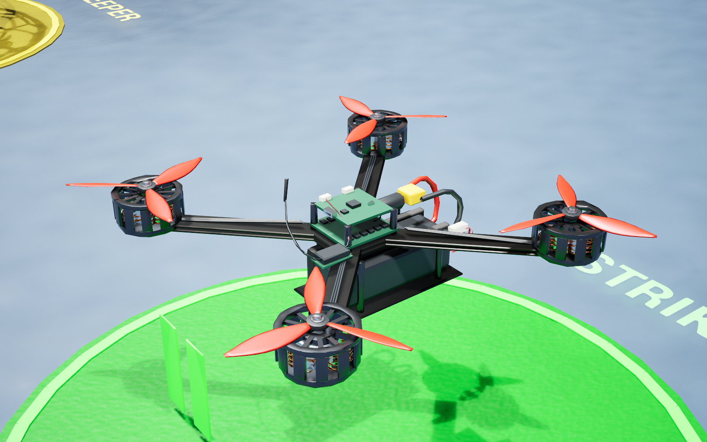
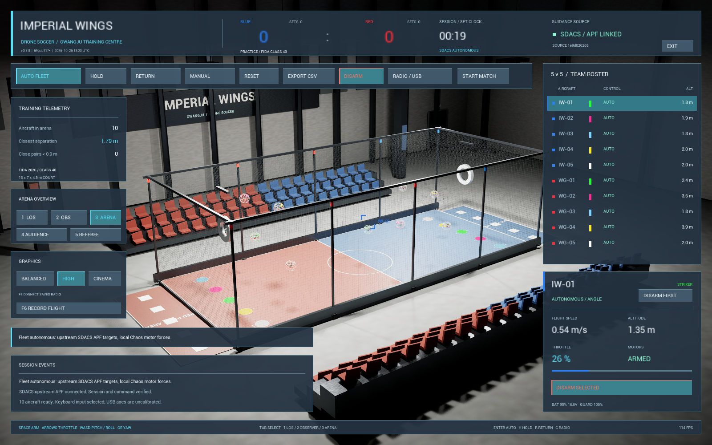
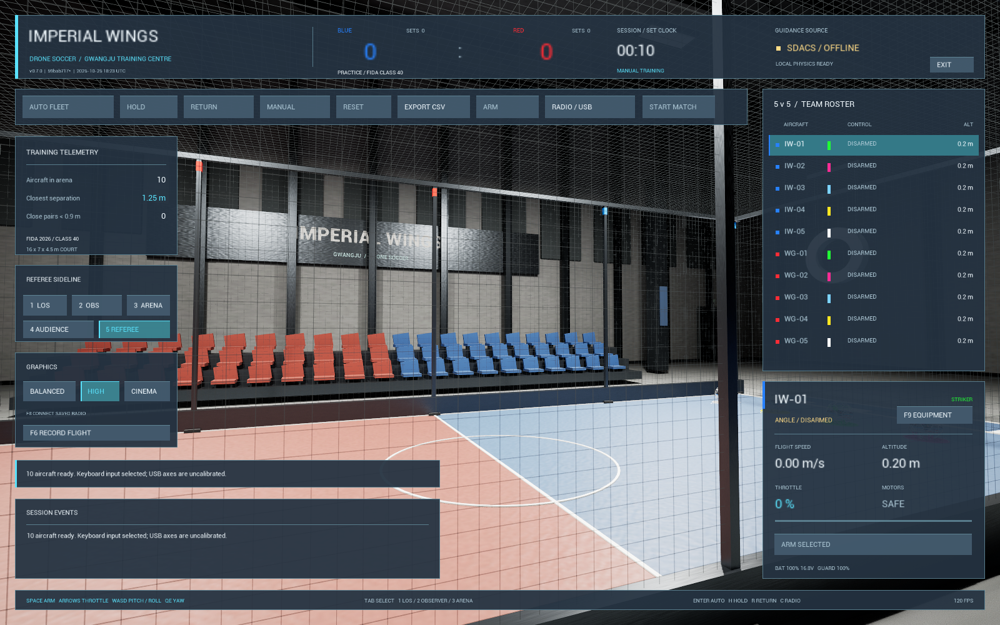

# v0.7.0 — 내부 장비·접촉 반응·보기 분리와 자율비행 피드백

검증일:2026-10-27 KST. Windows x64 Shipping / Unreal5.8.3. [실행 ZIP](https://github.com/sun475300-sudo/Drone-Soccer-Simulator/releases/download/v0.7.0/ImperialWings-Windows-v0.7.0-r3.zip)을 전체 압축 해제하고 `ImperialWingsLauncher.exe`를 실행한다. Python·Git·Unreal 설치는 필요하지 않다.

## 사용 중 달라진 점

- 자체550개 부품의 FC/ESC·수신기·안테나·모터 권선·배터리·커넥터·배선과 CW/CCW 프로펠러를 추가했다. DISARM 후 F9로 내부를 보고 다시 F9로 LOS에 복귀한다.
- 1 파일럿 LOS / 2 기체 추적 / 3 경기장 전체 / 4 관객석 / 5 심판 측면을 독립 카메라로 나눴다. 관객·심판은 비행 조작을 제한하며 수동 비행 중 진입하려면 DISARM해야 한다. F10으로 패널을 줄일 수 있다.
- 가드 충격량에 따른 GUARD %, 마모 흔적·파편 효과·이벤트·접촉 재질 변화를 추가했다. Backspace/RESET으로 복원한다. 강체 충돌 구체와 기체 질량0.9kg은 유지하며 실제 부품 파단·수명 인증은 아니다.
- 골대는 실제 용접 강체 합계12.5kg이다. 연습에서는 좌우 회전 없는 작은 앞뒤 반응·감쇠, 정규 경기에서는 고정 지지를 사용한다. 움직인 골대 기준 전체 기체 통과를 판정한다.
- 자율 경로의 팀별 고도·골대 아래 출발 경로·귀환 착륙 조건과 제한된 적분 보상을 보강했다. 모터 정지는 중심28cm·홈 수평20cm·속도0.2m/s 아래에서 수행한다. 생성 높이를25cm로 낮춰 시작 낙하로 인한 가드 소모를 없앴다.
- v0.6.1의 간소 조종기 화면·저장 프로필·배포 구조와 확장된 계획서를 통합했다. 개인 조종기 프로필은 배포하지 않는다.
- 계획서 RV-01/AI-11을 수정했다. HOLD/RETURN·기체 API·HTTP 목표를 Practice로 제한하고, 세트 종료에는 자동 귀환 대신 기존 수동 착륙 조종을 유지한다. Ready/Playing/Break/Finished에서 자율 진입을 거부하고 정비/종료 단계의 새 ARM도 거부한다. 간소 화면에도 실제 카메라 역할명을 표시한다.

## 최종 실행 파일 검증

| 검사 | 결과 |
|---|---|
|30/60/120FPS 실제 물리 | 호버 오차3.297/3.150/2.988cm. 바닥/벽·5m/s 네트·실제 스트라이커 골 통과/오프사이드 통과 |
|20/30/60/120/240FPS 수동 ANGLE |10대 초기 자세 복원·입력 기울기·중립 복원 통과. 최악 최종 기울기0.167° 미만 |
|30/60/120FPS 가드·골대 접촉 | 두 연습 충돌에서 내구도 감소·마모/효과·정지 무마모·감쇠·초기화 통과. 정규 경기 지지 고정 충돌도 통과 |
| 실제 골대 질량·변위 | 세 주기 모두12.5kg. 연습 최대 수평 변위5.38~5.47cm,12초 후1.13~2.12cm로 감소. 정규 경기 충돌의 최대 변위0.20cm 미만 |
|6개 보기 | 실제 CameraManager 위치/보기 전환·관객/심판 ARM 거부·장비 보기 ARM 거부·LOS 복귀 통과.10대 초기 정착 후 가드100% 확인 |
|10대 모델/배치 | 새 메시 로딩·무충돌·0.9kg·LED/역할/시작 패드/LOS 위치·하단 띠 검사 통과 |
| 실제 APF/Chaos 통합 |10대 이륙·HOLD·귀환·통신 장애 HOLD·재연결 시 자동 재개 금지·명시적 귀환·10대 착륙/DISARM·정규 경기4단계의 AUTO/HOLD/RETURN·기체 API 거부와 종료 수동 착륙 유지 통과 |
| 통합 자율 수치 | 최소 간격1.098m, HOLD4초 중 최대 이동28.89cm, 최고 중심 높이3.952m, 최대 기울기5.198° 미만.55.304초 시점 전체 착륙/DISARM |
| 효과 풀 | Balanced96 / High192 / Cinematic256 상한·수명 후0개 확인. 비행 정확도와 다른 표시효과 시험 |
| ZIP 새 압축 해제 | 한글·공백 경로, 개발 도구 PATH 제거, 네이티브 실행기 조회·독립 APF 실제10대 응답·새 사용자 설정·개인 프로필 무포함12개 검사 통과 |
| 독립 검사 | 규칙57·물리104·USB 보정 수학161·요청 순서16·실제 APF HTTP11·보호구 기하4·비행 기록 판정5개 통과 |

명시적인 프레임 검사만 고정 게임 간격을 지정하며 실제 최소/최대 Tick 간격과 입력 지문을 검증했다. 자율 HTTP 장애 시험은 실시간으로 수행했다. 이 수치는 별도 명령/API 기반 시험이며 물리 조종기를 움직인 기록이 아니다.

실제 GPU 자율 렌더는 개발 PC의 RTX5070Ti / RAM32GB에서 High·1600×1000·10대 APF 훈련으로 확인했다. 초기3초 뒤1721표본의 평균114.66FPS, p95 프레임 시간9.682ms다. 짧은 로컬 시험이며 다른 GPU·긴 경기·콜드 셰이더 컴파일·USB 지연의 보증이 아니다.

## 배포와 재현

- 실행 ZIP: `ImperialWings-Windows-v0.7.0-r3.zip`,374,744,460bytes.
- ZIP SHA-256: `3ded30405e8290d69e35a3a0a3b48e786ac9000be2c6877a71e683bea87e4d4e`.
- 최종 입력SHA-256: `5634f0bd80e6dd09013841e3537d484eb90130160380679bebc4770192e8da4e` /108개 입력.
- 컴파일 기준 부모커밋: `59bab71788608db2956b35dd559aba8c9438ffdb`. 이후 변경한 작업 트리에서 컴파일했으므로 실행 파일과 공개 소스의 대응은 위 입력 지문으로 확인한다.
- 원본 APF: `swarm-drone-atc`의 `1e9d826265069696d7e415c7778d17483d7a8580`, 실제 원본 해시·라이선스를 번들에서 확인한다.
- 자동 시험: `run-contact-view-tests.ps1`, `run-angle-tests.ps1`, `run-runtime-tests.ps1`, `run-role-layout-tests.ps1`, `run-presentation-tests.ps1`, `run-autonomy-feedback.py`, `test-portable-release.py`. 패키지 경로에는 이번 버전의 `Windows` 폴더를 지정한다.
- 실제 GPU 재현: `Tests/render-autonomy-preview.py --repo <원본> --executable <Shipping 실행 파일>`. USB 입력·외부 메시지 전송은 없다.

원시 시험 결과는 로컬 `Saved/Verification`에 남겼다. 공개 [수치 요약](../verification/v0.7-summary.json)은 개인 경로·조종기 프로필을 제외한다. 실패한 중간 시험은 최종 통과 기록과 구별하며 [자체 피드백](../autonomy-feedback-v07.md)에 원인·수정을 남겼다.

실제 Boxer는 배터리 부족으로 분리되어 이번 버전의 전체 실물 비행·케이블 분리/재연결을 재시험하지 않았다. 실제 다른 PC/HID/GPU 현장 시험, 실측 물리 계수, 정밀 파단·네트 연성체·전체 심판·전술AI·멀티플레이·리플레이는 남아 있다. 계획서 전체의326개 기능을 완료했다는 뜻이 아니다.
