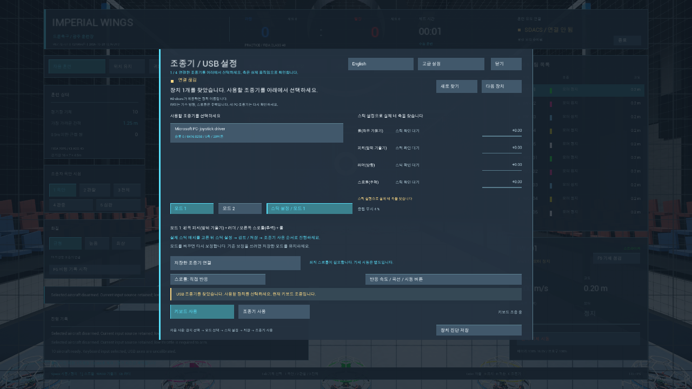

# v0.7.12-rc1 — 한국어 조종기 안내·간단 설정·안전한 보정 저장

작성일: **2026-10-28**. 이 버전은 **한국어 조종기 안내와 안전 저장을 우선한 Windows 사전 배포판**이다. 아래 검사는 같은 소스 입력 지문의 Editor·Shipping 실행본과 새 경로 ZIP에서 수행했다. 실물 조종기·다른 PC의 미검증 범위는 별도로 명시한다.

구현 기준은 최신 완료 커밋 `12150cef7d31c8bf42367db20866d35406993675`의 v0.7.10-dev AI 연습·대전이다. 기존 조종기 Mode 1/2·레이트/Expo·아밍 버튼 설정을 보존하며 한국어 사용 안내를 보강한다. **별도 작업 중인 Topgun 코스는 이 후보에 포함하지 않는다.** 기존 공개 `v0.7.4`의 `ImperialWings-Windows-v0.7.4-r2.zip`을 교체하거나 덮어쓰지 않는다.

[다운로드·실행 안내](../../README.md#windows-run) · [다른 PC에서 실행하기](../PORTABLE_QUICK_START.ko.md) · [Boxer 상세 보정](../BOXER_SETUP.md) · [전체 개발 계획](../master-development-plan.md).

## 이번 변경

- **한국어·영어 안내:** 처음에는 한국어로 안내하며, C로 여는 조종기 설정 화면의 제목 오른쪽 언어 버튼으로 English/한국어를 전환한다. 장치 선택, Mode 1/2, 스틱 보정, 저장·활성화와 실패 시 다음 행동을 번역한다. 언어 선택은 Windows 사용자별 `Saved/Config/Language.txt`에 저장한다. 이번 범위는 조종기 중심이며, AI·경기·결과를 포함한 모든 화면의 완전한 번역은 아니다.
- **첫 설정 흐름:** 실제 USB 장치 선택 → 스틱 배치 선택 → 스틱의 전체 범위·중립·방향 확인 → 검토 후 저장 → 최저 스로틀에서 USB 활성화 → 별도 ARM 순서다. 기존 간소 화면과 단계형 보정을 활용하고 고급 레이트·Expo·아밍키 설정을 유지한다. 미보정 기본 축을 실제 측정·확인한 배정처럼 표시하지 않는다.
- **저장 실패 시 이전 보정 보존:** 보정·정밀 스로틀·레이트/아밍 설정을 고유 임시파일에 쓴 뒤 Windows 파일 교체로 반영한다. 대상 파일이 잠겼거나 쓰기 권한이 없으면 기존 목적 파일을 먼저 삭제하지 않으며, 메모리 설정도 성공 후에 반영한다.
- **기존 조종 기준 유지:** LOS·ANGLE·최대 목표 기울기35도, Mode 1/2, 명시적 USB 활성화·ARM 조건을 유지한다. ANGLE은 자세를 수평으로 복원하며 높이는 스로틀로 직접 조절한다.

구현 코드는 격리 작업 폴더에서 작성했다. 기존 프로젝트의 문서 변경, 진행 중인 Topgun 소스, 실제 조종기 보정 파일은 덮어쓰지 않았다.

## 새 PC에서 처음 실행하기

1. 이 버전의 **Windows 실행용 ZIP**을 받는다. 후보 파일명은 `ImperialWings-Windows-v0.7.12-rc1.zip`이다. GitHub의 `Source code` ZIP은 직접 빌드할 개발 소스이므로 실행용 파일과 구분한다.
2. 기존 실행 폴더와 다른 **새 폴더**에 ZIP 전체를 압축 해제한다. ZIP 창 안에서 실행하거나 EXE 하나만 옮기지 않는다.
3. 실행기 옆의 **`START_HERE.ko.md`**를 읽고 **`ImperialWingsLauncher.exe`**를 연다. `Windows`·`Guidance`·`Prerequisites` 폴더를 함께 보관한다. 일반 실행에 Unreal Editor·Python·Git의 별도 설치는 필요하지 않다.
4. Visual C++ 실행 구성 요소가 없다는 오류가 나면 동봉한 **`Prerequisites/vc_redist.x64.exe`**를 설치한 뒤 실행기를 다시 연다. Windows 10/11 x64와 DirectX12·Shader Model6 지원 GPU가 필요하다.
5. 키보드를 사용하려면 조종기 화면에서 키보드 입력을 선택하고 창을 닫는다. USB 조종기를 사용하려면 아래 보정을 진행한다.
6. 처음에는 연습 상태에서 스로틀을 내리고 별도로 ARM한다. 경기 시작·프로필 불러오기·케이블 재연결이 자동 ARM이나 이륙을 수행하지 않는다.

업데이트는 이전 실행 폴더에 일부 파일을 덮어쓰는 방식 대신 새 폴더에서 확인한다. 사용자 설정은 `%LOCALAPPDATA%/ImperialWingsSimulator/Saved`에 별도로 저장되므로 새 실행 ZIP에 개인 설정을 넣지 않는다. 같은 Windows 사용자와 같은 조종기라면 지원되는 기존 보정을 불러올 수 있지만, 새 PC·새 사용자에서는 실제 장치를 다시 확인하고 보정한다.

## Boxer 보정·재연결

1. 조종기를 켜고 데이터 전송용 USB 케이블로 연결한 뒤 송신기에서 **USB Joystick**을 선택한다. 장치가 나타나지 않으면 Windows **Win+R → `joy.cpl`**에서 실제 스틱 입력을 확인한다.
2. 게임에서 실제 장치를 명시적으로 선택하고 Mode 1 또는 Mode 2를 고른다. **Mode 1은 오른쪽 세로 스로틀, Mode 2는 왼쪽 세로 스로틀**이다. 배치 선택만으로 기존 저장 축을 자동 재배정하지 않는다.
3. 안내 보정에서 축 하나씩 전체 범위를 움직이고 방향·중립·스로틀 최저를 확인한다. 최종 검토 후 저장하고, 최저 스로틀에서 USB를 활성화한 다음 창을 닫아 별도로 ARM한다.
4. 이미 보정한 장치는 최저 스로틀에서 **F8 / 저장 조종기 연결**로 다시 연결한다. 연결 손실·다른 앱으로의 창 전환 후에는 USB 활성화와 ARM을 다시 확인한다.

개발 PC의 실제 Boxer 근거는 **Roll X · Pitch Y · 러더(Yaw) V · 스로틀 Z**다. 특히 스로틀 Z와 러더 V를 바꾸어 배정하지 않도록 검토한다. 이 값은 해당 실물·USB 구성의 기록이며 다른 PC나 다른 조종기의 고정 기본값이 아니다. 프로그램은 실제 움직임으로 배정을 확인하며, 배포본에 개발자의 보정값을 복사하지 않는다.

장치 슬롯·USB 설정·펌웨어가 바뀌거나 같은 모델이 여러 대 연결되면 기존 장치 식별이 달라질 수 있다. 저장 장치를 유일하게 확인하지 못하면 장치를 다시 선택하고 필요 시 새 보정을 진행한다. WinMM 장치 이름·축 수만으로 모든 기기와 고유 시리얼을 식별하거나 모든 USB 조종기 호환을 보증하지 않는다.

## 이번 검사 상태

예전 버전의 성공 기록을 이번 실행 결과로 합산하지 않는다. [이번 소프트웨어 검증 요약](../verification/v0.7.12-rc1-summary.json)과 릴리스에 첨부된 최종 지문·파일 해시를 확인한다.

| 검사 | 이번 상태 | 범위·근거 |
|---|---|---|
| 독립 조종기 보정 | **205개 통과** | 이번 작업에서 실행. 수치·상태 전이 검사이며 실물 USB 입력 시험은 아님 |
| 독립 레이트·Expo·아밍 버튼 | **4,881개 통과** | 이번 작업에서 실행. 응답·버튼 조건의 소프트웨어 검사 |
| 한국어·영어·저장 실패·재실행 | **Editor/Windows 각각47개 통과** | 한글 GPU 화면1600×1000/1280×720, 잠긴 언어 파일·동적 숫자 안내 포함 |
| 보정 저장 실패·기존 파일 보존 | **통과** | 격리 QA 파일의 잠금/쓰기 실패·기존 내용·UTF8/한글 경로·임시파일 정리 확인. 실제 보정 파일은 미수정 |
| Unreal 빌드·입력/Mode1·2 회귀 | **통과** | Editor·Shipping 빌드/패키징, 각 Mode20개·입력29개, Shipping 응답66개·AI대전94개·10대ANGLE20/60/240FPS |
| 새 경로 Windows ZIP | **13개 통과** | 한글·공백 경로 전체 해제, 파일해시·개인설정 제외·실행기/APF·신규 사용자 저장, 개발 도구 없는 PATH |
| 실제 Boxer 연속 비행·아밍키·케이블 분리/재연결 | **미검증** | 실제 사용자의 스틱·케이블 동작이 필요함. 합성 입력으로 대체하지 않음 |
| 다른 물리 PC에서 설치·보정·비행 | **미검증** | 같은 PC의 새 경로·새 사용자 데이터 시험과 구분 |
| GitHub 새 릴리스·다운로드 재검증 | 준비 중 | 실제 공개·재다운로드 해시 확인 후 기록 |

기존 AI 대전·배포·비행 검증 기록은 [검증 문서](../verification.md)에 보존한다. 과거 결과가 이번 변경 이후 동일 실행본의 새 검사를 뜻하지는 않는다.

## 배포 확인 항목

| 항목 | 초안 상태 |
|---|---|
| 새 릴리스 후보 | `v0.7.12-rc1` — 기존 `v0.7.4`와 별도 |
| Windows ZIP 후보 | `ImperialWings-Windows-v0.7.12-rc1.zip` |
| 소스 기준 | `12150cef7d31c8bf42367db20866d35406993675` + 이번 한국어·조종기·안전 저장 변경 |
| 빌드 입력 SHA-256 | `02dcd472c5c5506aff605d0356145e421914c548c4dee636f56055886b7430b3` |
| ZIP 바이트 수·SHA-256 | 최종 릴리스의 `SHA256SUMS.txt`와 `v0.7.12-rc1-summary.json`에 기록 |
| 실행본·새 ZIP 결과 | [소프트웨어 검사 요약](../verification/v0.7.12-rc1-summary.json) 및 릴리스 첨부 자료 |
| GitHub Assets·재다운로드 해시 | 공개 완료 후 확인 예정 |

새 배포본에는 개인 `RadioProfile.json`·`PilotControls.json`·`PilotResponse.json`·`Language.txt`나 생성된 `Saved` 폴더를 포함하지 않는다. 실제 하드웨어 시험·모든 화면 번역·Topgun·LAN/온라인5대5·전체326개 기능의 완료를 주장하지 않는다.

