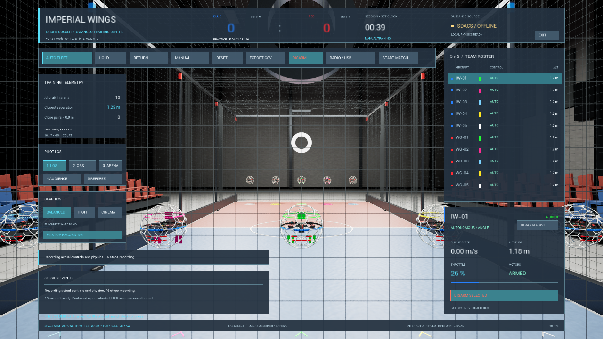

# v0.7.2 — 시간 계산·자율 착륙·다운로드 안내

2026-10-27 KST. [공개 수치](../verification/v0.7.2-summary.json) ·
[시간 계약](../time-contract.md) · [중단·미완료 목록](../work-status-2026-10-27.md).

## 문제와 변경

기존 기체는 게임 프레임의 최대50ms만 모터·배터리에 반영했다. 실제100/250ms 정지를
주입한60초 실행에서 Chaos보다 모델 시간이33.333ms 뒤처지고 센서 시간은220.967ms
앞서는 실패를 재현했다. 이를 성공 기록으로 바꾸지 않고 보존했다.

기체의 힘 계산을 동기 Chaos 장면 시작 콜백으로 옮겨 장면의 실제 계산 예산을 공유한다.
자율 속도 적분·모터·PID·전력·IMU 시간·네트 접촉 힘이 같은 간격을 받는다. 이미 진행된
이전 간격으로 각가속도·가속도를 계산한다. 현재는 장면 프레임당1회 제어이며 독립
고정120Hz PID나 서브스텝마다의 제어를 구현한 것은 아니다.

경기 시계는 엔진 게임 시간을 반영한다. 물리 예산을 넘은 시간은 버리고 나중에 몰아
재생하지 않는다. HUD의 `PHYSICS LIMITED`와 F6 `timing`에 생략·처리·보류0·횟수를
기록한다. 예산과 실제 solver 완료 시간을 별도로 대조했다.

자율 회귀 검사에서는2대가33~35cm에서 멈춰125초 안에 착륙하지 못했다. 실제 upstream
APF의10cm 목표 인력 데드밴드와 지면 회피가 착륙 끝부분에서도 상승 조언을 만드는 것을
확인했다. 비어 있는 착륙 기둥·패드 근처·65cm 이하에서만25cm 목표 높이를 명시한다.
이웃 기체가 같은 수평 기둥을 차지하면 APF 회피를 유지하고 마지막 목표 간격 투영도 유지한다.
위치를 강제로 옮기거나 높은 곳에서 ARM을 끄지 않는다. 기존28cm 미만·저속 DISARM 조건을 유지한다.

README는 실행용 ZIP과 소스 ZIP을 구분하고, Assets 선택·전체 압축 해제·실제 폴더 구조·
실행기·Visual C++ 설치 파일·업데이트·경로 오류·해시 확인까지 상세히 설명한다.
안내는 **조종기 설정**으로 통일하며 자동 보정의 Mode2 기준과 다른 배치의 수동 설정을 구분한다.

## 최종 실행 검사

| 검사 | 결과 |
|---|---|
| 실제60초·10대 로컬 HOLD 정상 실행 | 게임/solver 약60.010초, 생략0, 모델/센서 최대 시간 오차 약1.1×10⁻¹²초 |
| 실제100/250ms 정지·10대 HOLD | 모델/센서 시간 일치, 생략0.240817초를 장부에 기록, 자세·속도·호버 안정성 통과 |
| 공식 수동 경기60초·100/250ms 정지 | 경기 타이머 약60.007초, 물리 약59.787초, 생략0.219762초·보류0,10대 수동/DISARM 유지 |
| 실제 F6 파일 | 각60초 시험의 start/sample/stop·10대·시간 장부·전류/소모량 기록 확인 |
| 실제 upstream APF/Chaos 자율 | 출발·HOLD·3.8초 HTTP503·로컬 유지·복구 뒤 자동 재개 거부·명시적 귀환·54.32초 전기체 착륙/DISARM |
| 자율 간격/유지 | 최소 간격1.071m, HOLD 최대 이동29.53cm, 경기4단계 자율 진입 차단 통과 |
| 수동 ANGLE |20/30/60/120/240FPS·10대, 최악 중립 복원0.167° 미만 |
| 호버·접촉·네트·실제 골대 |30/60/120FPS, 호버 오차3.297/3.150/2.988cm, 모두 통과 |
| 마모·골대·보기·기체 배치 |3개 접촉 간격,6개 시점,10대 모델/역할 패드·LOS·띠 검사 통과 |
| 입력 복구 | Shipping29개·새 ZIP29개 엔진 키/뷰포트 API 검사 통과 |
| 유도·배포 | APF 연동13개(착륙 실패 재현 후 보완 포함), 새 ZIP12개 검사·설치 도구 없이 APF/새 사용자 경로 통과 |

새 ZIP을 한글·공백 경로에 실제 해제했다. 설치 Python/Git·개발 경로 없이 포함된 APF를
실행하고 실제10대 protocol2 요청·프로비넌스·사용자 저장·보정 미생성을 확인했다.
기존 실제 조종기 보정 파일은 보존한 원본과 바이트가 같다. 개인 보정값은 배포하지 않는다.

위 이미지는 명시적 지연 시험의 실제 Shipping GPU 오프스크린 렌더다. OS 화면 조작이나
실물 조종기 비행의 증거가 아니며, 이 실행의 실제 캡처 크기는1280×720이다.

## 파일·재현·한계

- Windows ZIP: `ImperialWings-Windows-v0.7.2-r2.zip`,374,764,753bytes.
- ZIP SHA-256: `265be3483f3e5b618b3301872efae0b133a504adda4b938078700dd81fbbd1a3`.
- 빌드 입력 SHA-256: `39189d9c53e9f4337124a84a7a15c56289c70e1aaf538bda130db11318e571d7`,114개.
- 빌드 기준 부모커밋: `d07d57ce8a6643bea5b0f3e33b8eae77945e439c`. 변경 작업 트리에서 빌드했고 공개 소스와 입력 지문으로 대조한다.
- 실제 upstream APF: `1e9d826265069696d7e415c7778d17483d7a8580`. upstream 파일은 수정하지 않고 어댑터의 종단 착륙 목표만 보완했다.
- 재현: `Tests/run-time-contract-tests.ps1 -Packaged -PackageRoot <Windows 폴더>`에 `-Hitches`·`-Official`·`-RenderCapture`를 선택한다. 자율 시험은 `Tests/run-autonomy-feedback.py`, 유도 검사는 `Bridge/test_sdacs_bridge.py`다.

이번 버전에서도 **실물 USB/OS Alt-Tab·다른 물리 PC·입력 지연·실측 기체 계수·독립 고정
물리 스레드·정밀 파단·전체 심판/승계·멀티플레이·리플레이·전체326개 기능은 미완료**다.
ANGLE은 자세 복원이며 고도 유지는 아니다. 호버 스로틀 곡선과 고출력 배터리 공급 한도의
실제 추력 연결은 별도 검토 대상으로 남긴다. 장면 시간 일치를 실기체 정확도로 표현하지 않는다.
