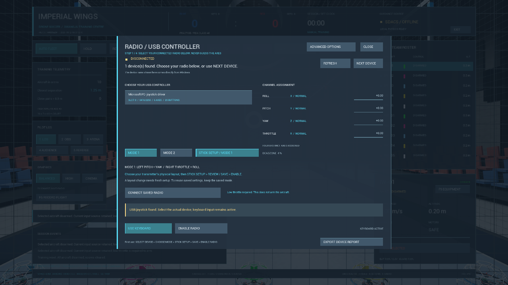
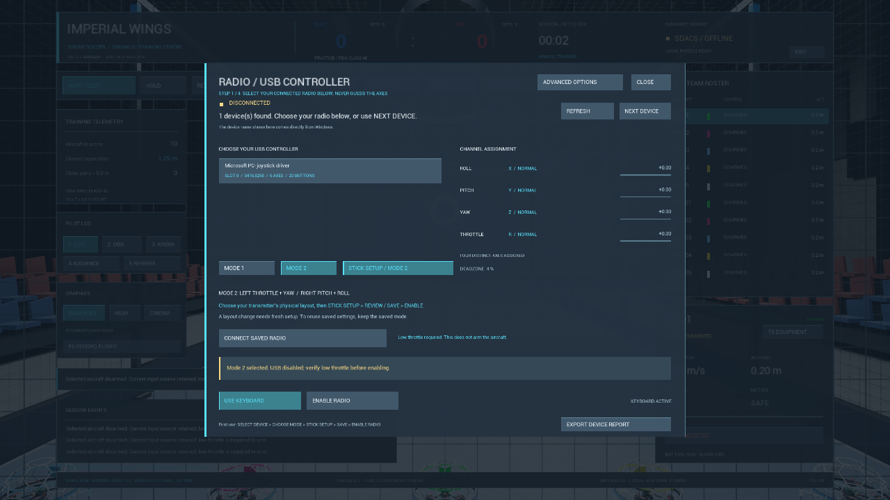

# v0.7.3 — Mode 1·Mode 2 조종기 설정

## 변경

조종기 설정에서 **MODE 1 / MODE 2**를 선택하고 **STICK SETUP**을 진행한다.
Mode 1은 왼쪽 Pitch/Yaw·오른쪽 Throttle/Roll, Mode 2는 왼쪽 Throttle/Yaw·오른쪽 Pitch/Roll이다.
각 단계의 움직일 손·유지 방향·중립 그림과 최저 스로틀 안내가 선택 모드를 따른다.
USB 축 번호를 가정하거나 기존 Pitch/Throttle 값을 단순 교환하지 않고 실제 움직임으로 측정한다.

선택 변경은 USB를 해제한다. 다른 모드의 보정으로 ENABLE·SAVE·F8 빠른 연결을 진행하지 않는다.
수집 중 모드 변경을 막고, 취소하면 이전 보정과 그 모드를 복원한다. 최종 검토·저장 전 디스크의 기존 보정은 유지한다.
저장 프로필의 `stick_mode`는1또는2이며 누락된 예전 프로필은 Mode 2로 읽는다. 잘못된 값은 거부한다.
모드 선택을 따로 하지 않은 새 실행의 F8 연결은 저장 모드를 불러온다. 방금 선택한 모드와 저장 모드가 다르면 빠른 연결을 차단한다.
장치별 저장은 기존과 같이 하나의 최신 프로필이며, 같은 장치의 두 모드를 동시에 별도 슬롯으로 보관하는 기능은 아니다.

[조종기 설정 방법](../BOXER_SETUP.md) · [다른 PC 실행](../PORTABLE_QUICK_START.ko.md).

## 검사

- Unreal Engine5.8.3 Editor와 Windows Shipping 빌드 성공.
- 독립 보정 검사205개 통과: 두 배치의 실제 측정 방식, 서로 다른 축 순서·방향, 피치/스로틀 분리, 중립·최저 출력, 취소와 잘못된 모드.
- 실제 Shipping의 HUD 버튼·모드 JSON 검사20개 통과: 선택/재선택, 패널 열기DISARM, USB 비활성, 패널 재개, 예전 프로필 모드 기본값, 직렬화 왕복과 잘못된 메타데이터 거부.
- 실제 Shipping 입력 안전 회귀29개 통과. 엔진 키 이벤트/Viewport API 검사이며 실제 OS/HID 조작을 뜻하지 않는다.
- 아래 이미지는 실제 실행본을 화면 밖에서 렌더한1280×720 캡처다. 장치가 선택되지 않은 상태에서 모드 화면만 확인했다.





## 범위와 재현

조종기는 배터리 부족으로 분리돼 있어 이번에는 실물 Mode 1·Mode 2 스틱 비행을 수행하지 않았다.
원래 개인 보정 파일을 보존했다. 입력을 가짜 HID 장치로 만들거나 개인 보정 파일을 배포하지 않았다.
JSON 모드 저장·읽기 함수는 실제 프로필 저장 경로와 공유하지만, 실물 장치로 전체 프로필 저장→앱 재실행→F8 활성화하는 현장 시험은 별도다.
기존 LOS·ANGLE 비행 물리·경기 규칙은 이 변경의 범위 밖이며 v0.7.2의 모든 물리 시험을 새로 반복했다고 표시하지 않는다.

[기계 판독 검사 결과](../verification/v0.7.3-summary.json).
빌드 입력 지문: `a307273e71778f07e102b83fd4269e59129a49b3012937e5f46a9085855cdcb4`(118개).

```powershell
.\Tests\run-radio-tests.ps1
.\Scripts\Build.ps1 -Package -Configuration Shipping -PackageRoot '<경로>\Windows'
.\Tests\run-radio-mode-tests.ps1 -Packaged -PackageRoot '<경로>\Windows' -RenderCapture
.\Tests\run-input-safety-tests.ps1 -Packaged -PackageRoot '<경로>\Windows'
```

검사는 새 사용자 데이터 폴더를 지정하며 물리 조종기를 선택하거나 스틱 보정 파일을 생성하지 않는다.

## 배포 ZIP

`ImperialWings-Windows-v0.7.3-r1.zip` /374,769,289bytes.
SHA-256: `19c9b6308bd068d0f5b9ad24dabaed8a4352cb990ced4a9f4bef83056f24c3b4`.

전체 압축 해제한 한글·공백 경로에서 모드 UI/JSON20개를 다시 통과했다.
개발 도구 경로를 제거한 독립 실행 환경의12개 검사도 통과했다: 파일 해시·개인 설정 미포함,
실행기 경로 해석·Python/Git 없는 APF10대 응답·새 사용자 데이터의 키보드 시작·보정 파일 무생성.
실제 다른 물리 PC에서 조종한 결과는 아니다. 실행기는 GUI 자동 실행 대신 경로 해석 검사를 사용했다.
