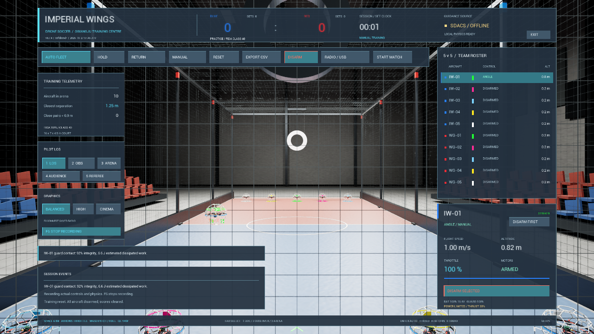
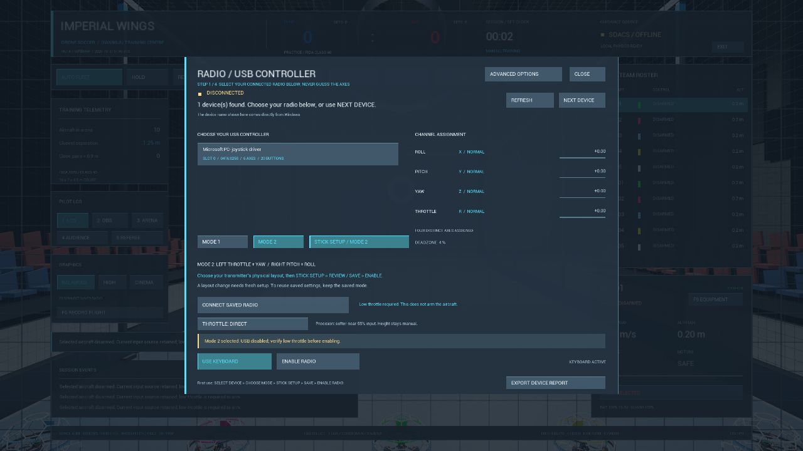

# v0.7.4 — 전력 제한·정밀 스로틀·득점 경계 수정

기록일: **2026-10-27 KST**. **r2 실행본과 새 경로의 배포 ZIP 검사를 통과했다.** [기계 판독 결과](../verification/v0.7.4-summary.json)에 동일 소스 지문의 검사 결과를 모았다. 공개하지 않은 r1은 중앙선 복귀 경계 오류 수정 전 시험본이며, 검증한 배포 파일은 `ImperialWings-Windows-v0.7.4-r2.zip`이다.

[다운로드·실행 방법](../../README.md#windows-run) · [조종기 설정](../BOXER_SETUP.md) · [순차 작업 목록](../sequential-work-2026-10-27.md).

## 배터리 공급 한도를 실제 모터 출력에 연결

이전 모델은 배터리 전류·공급 전력을 제한해도 그 한도가 모터의 실제 추력에 충분히 연결되지 않았다. 수정 전 Unreal 시험에서 계산된 모터 전력이 배터리 공급 전력을 초과했다.

| 수정 전 조건 | 모터 전력의 최대 공급 초과량 |
|---|---:|
| 최대 전류 80A, 최대 스로틀 | 445.78W |
| 최대 전류 10A, 최대 스로틀 | 2,379.61W |
| 최대 전류 0.1A, 항전 부하 공급 부족 | 2,707.76W |

근거는 `Saved/Verification/power-20261027-072436-806-e35a9582/result.json`이다. 이는 **실험 모델 내부의 전력 수지 실패값**이며 전력계로 측정한 실기체 소비 전력이 아니다. 당시 일부 시험은 이후 보완한 계측 조건을 사용하므로 최종 성능 수치로 인용하지 않는다.

수정된 힘 계산은 같은 단계에서 네 모터의 요구 전력, 배터리 공급 전력과 항전 부하를 계산한 뒤 남은 모터 전력 예산을 적용한다. 공급이 부족하면 모터 추력·회전수 상태와 반작용 토크를 함께 제한하고 배터리는 한 단계에 한 번 적분한다. 전류 한도 0, 빈 배터리, 항전 장비에도 부족한 공급을 별도로 처리한다.

출력 제한은 자세 PID의 포화 처리에 포함하며, 자율 속도 제어의 적분값도 제한 중 감쇠한다. 이는 출력 부족 중 제어 오차가 계속 누적되는 현상을 줄이기 위한 처리다. HUD에 `POWER LIMITED / THRUST %`와 `BATTERY EMPTY / NO MOTOR POWER`를 표시하고 F6 기록에는 요구·가용·적용 모터 전력과 추력 배율을 남긴다.

모터·배터리·항전 부하·표면 효과·후류 계수는 여전히 **실험값**이다. 전력 수지를 만족한다는 결과가 HELSEL STRIKER V3의 실제 추력·전류·비행시간 또는 보호구 공력과 일치한다는 뜻은 아니다.

## 선택형 정밀 스로틀

조종기 설정의 `THROTTLE: DIRECT / PRECISION`에서 선택한다. 새 사용자 기본값은 **DIRECT, 정밀 기능 OFF**다. 정밀 설정은 USB·키보드 수동 입력에 적용하며 자율비행 스로틀에는 적용하지 않는다.

- 정규화 입력의 기준점은 **55%**, 기준점의 출력 변화율은 **0.65**다. 입력 0%·55%·100%의 값과 최대출력을 유지하며 범위 전체에서 엄격하게 증가한다.
- 곡선은 기준점에서 값·1차·2차 미분이 이어지는 `C²` 형태다. `u`를 0~1 입력, `d = u - 0.55`, `a = 0.55`(기준점 아래) 또는 `0.45`(기준점 이상)로 두면 `f(u) = 0.55 + 0.65d + 0.35d³/a²`다. 범위 밖 값은 제한하고 유효하지 않은 수는 0으로 처리한다.
- 이는 **입력 감도 조절**이다. 55%가 모든 배터리·자세에서 호버하는 스로틀이라는 뜻은 아니다. ANGLE은 자세를 수평으로 복원하며 고도는 계속 조종자가 조절한다.
- 보정 중 또는 수동 기체가 ARM 상태이면 변경하지 않는다. 저장 성공 후 USB를 해제하므로 최저 스로틀에서 명시적으로 재연결한다. 저장 실패 시 이전 선택을 유지한다.
- 사용자 `Config/PilotControls.json`의 버전 1 설정에 별도로 저장한다. 실제 `RadioProfile.json`의 축·범위·중립을 변경하지 않는다. 잘못된 설정은 DIRECT로 시작하며 USB 연결·ARM을 자동 복원하지 않는다.
- USB 활성화와 ARM의 최저 스로틀 판정은 곡선 적용 **전** 입력을 사용한다. F6의 `throttle`은 보정·정규화된 곡선 전 값이며 HID 정수 원시값은 아니다. `throttle_command`와 `precision_throttle`로 적용 결과를 구분한다.

## 득점 후 중앙선 복귀 경계 수정

기체 중심이 정확히 `x = ±0.20m`이면 반경 20cm의 보호구가 중앙선에 닿아 있다. 보간 반올림 때문에 이 값이 자기 진영 안쪽으로 아주 조금 계산되어 오프사이드를 일찍 해제하는 오류를 재현했다. 양 팀에 `1e-9m`의 수치 여유를 적용하여 접촉·작은 수치 잡음은 해제로 인정하지 않는다.

독립 검사 **101개 통과**: 기존 57개, 양 팀·다섯 역할의 자격 30개, 통과 연속성 6개, 양 팀 복귀 경계 8개다. 수정 전 확장 검사는 94번째 단언에서 실패했다. [정확한 재현·분류·범위](../scoring-test-2026-10-27.md).

이 수정은 규칙 코어의 경계 처리다. Practice에서 실제 기체가 골대를 통과한 시험과 Ready부터 경기 종료까지의 심판 운영 시험은 구분한다. 역할 승계·카드·페널티 경기 진행·연장·VAR 전체를 구현한 것은 아니다.

## 피드백 양식 배포 — DOC-07

검토한 [독립 HTML 양식](../feedback-form.html)을 실행기 옆의 `feedback-form.html`로 넣는다. 전체 압축 해제 후 브라우저에서 열고, 관찰 내용을 입력한 뒤 **미리보기 → 내용 확인 → TXT/JSON 저장** 순서로 사용한다. 로그인·인터넷 연결 없이 작성하며 자동 전송하지 않는다. 파일 이름·설명 메모만 보고서에 넣고 실제 첨부 파일을 임의로 읽거나 포함하지 않는다.

배포 도구는 양식 원본·묶음 파일·manifest·체크섬 목록을 대조하며 양식 누락이나 불일치를 거부한다. 개인 `RadioProfile.json`, `PilotControls.json`과 생성된 `Saved` 폴더는 배포 대상에서 제외한다. 보고서와 필요한 기록은 사용자가 선택해 직접 전달한다. 양식 저장이 로그나 조종기 설정을 바꾸지 않는다.

## 검사 구성과 현재 확정 범위

| 검사 | 범위·현재 상태 |
|---|---|
| 독립 물리·조종기 보정 | 물리 122개·조종기 보정 205개 통과. 실제 장치 측정과 구분 |
| 독립 정밀 스로틀 수학 | 29개 통과. 범위·단조성·끝값·기준점 기울기·유효하지 않은 입력 등을 검사 |
| 독립 경기 규칙 | 101개 통과. 수정 전 실패와 회귀 조건을 함께 보존 |
| 실제 Unreal 전력 검사 | 80A/10A 최대출력, 0A, 항전 공급 부족, 빈 배터리, 중간 출력의 6개 시나리오. r2의 실제 20/60/240FPS 모두 6개 통과 |
| 실제 Unreal 정밀 스로틀 검사 | 각 20/60/240FPS에서 첫 실행 **6개**, 별도 프로세스 재실행 **36개** 항목. DIRECT/PRECISION 각각 입력 54%·56%·100%의 6개 힘 경로와 F6 기록을 대조. r2 최종 실행본에서 통과 |
| 기존 비행·경기 회귀 | 실제 10대 ANGLE, 호버·충돌·네트·골대 통과, 입력·Mode 1/2·시간 계약·APF 귀환/착륙. r2 최종 실행본에서 통과 |
| 새 경로의 배포 ZIP | 해시·원본 양식·개인 설정 제외·새 사용자 저장·독립 실행 환경 검사. r2 최종 실행본에서 통과 |

실행 검사는 실제 Unreal 기체·힘·Chaos 경로를 사용하지만 입력을 명시한 **비 USB 자동 시험**이다. 20/60/240FPS는 게임 Tick 조건이며 실제 최소/최대 Tick 간격과 빌드 입력 지문을 결과에서 대조한다. 이 수치가 독립 120Hz PID 또는 USB 지연을 의미하지 않는다.

## 중간 시험에서 보완한 계측 조건

중간 실행의 실패·불완전한 기록을 통과 결과로 합치지 않았다.

1. **천장 접촉 영향 분리:** 정밀 스로틀의 최대출력 비교는 기체가 천장에 도달하기 전 모델 시간 0.25초에서 측정한다. 기준점 부근은 0.9초를 사용한다. 천장 충돌을 겪은 장시간 최대출력 결과를 같은 조건의 출력 비교로 취급하지 않는다. 전력 예산 시험의 0.8초 구간과 목적이 다르다.
2. **시나리오별 모델 시간:** 각 시작 시점의 `ModelStart`를 보관하고 누적 모델 시간의 차이로 측정한다. 앞선 시나리오에서 쌓인 시간이나 렌더·게임 시간만으로 측정을 끝내지 않는다.
3. **F6 기록의 실제 수집 간격:** 화면 없는 고정 시간 시험이 실제 시간보다 빨리 진행되면 일반 F6 기록의 50ms 간격이 짧은 최대출력 구간을 놓칠 수 있었다. 명시적 시험에만 진행 속도 조절을 넣고, 일반 기록기가 DIRECT/PRECISION의 여섯 구간을 실제로 기록했는지 확인한다. 빠진 행을 합성하거나 일반 F6를 고정 20Hz 기록으로 주장하지 않는다.
4. **요청 FPS와 실제 Tick 대조:** 옵션 이름만 보고 프레임 조건이 달랐다고 판정하지 않는다. 결과의 `actual_min_game_dt_s`와 `actual_max_game_dt_s`가 요청한 간격에 맞는지 검사하고 불일치·누락을 거부한다.

## 최종 배포 확인란

| 항목 | 상태 |
|---|---|
| Windows ZIP | `ImperialWings-Windows-v0.7.4-r2.zip` |
| 최종 빌드 입력 지문 | `33e6f4eaed5089dc6a8e71a2c4e0b3cefa7c1d26e6d105616b67c6e9c6b2fe3b` — 123개 입력 |
| ZIP 바이트 수·SHA-256 | 374,786,305바이트 · `2bb10cc56b25a80e66a017b26b1cc236fe483460a15a8ea4e06ba39475b89cc6` |
| r2 실행·배포 검사 요약 | [공개 결과 JSON](../verification/v0.7.4-summary.json), 새 사용자/한글·공백 경로 13개·재실행 42개·전력 6개 통과 |
| GitHub 공개·다운로드 확인 | 릴리스 Assets와 별도 SHA256SUMS로 확인 |

공개 여부는 [릴리스 페이지](https://github.com/sun475300-sudo/Drone-Soccer-Simulator/releases/tag/v0.7.4)의 실제 Assets를 확인한다. ZIP의 파일명과 SHA-256을 대조한다.

빌드는 커밋 전 작업 파일에서 생성되어 내부 `source_commit`은 기준 커밋 `59f8b55`이고 `source_dirty=true`다. 최종 공개 소스와 실행본은 위 123개 빌드 입력의 SHA-256으로 대조한다. 문서·검사 로그용 JSON은 빌드 입력 지문과 별도로 소스 ZIP에 포함한다.

60FPS에서 54→56% 입력의 실제 추력 변화는 DIRECT 대비 **0.6501875배**였고 최대 스로틀 출력 차이는 0N이었다. APF 10대는 게임 시간 **54.24초**에 모두 착륙·DISARM했으며, 최소 간격 **1.11837m**, HOLD 최대 이동 **28.2821cm**였다. 공식 경기 시계는 100/250ms 지연을 포함해 **60.0123초** 진행했고 수동·비무장을 유지했다. 시간 검사 원본 JSON의 공통 `scope` 문구에 남은 HOLD 설명은 이번 공식 경기 플래그와 구분해 공개 결과에 주석을 붙였다.

위 이미지는 최종 실행본의 실제 화면 밖 렌더이며, 기본 DIRECT 상태다. Precision 활성화·USB 입력이나 다른 PC 시험 이미지로 표시하지 않는다.

## 남은 범위

실물 조종기 Mode 1/2 연속 비행·USB 손실/복구·지연, 다른 물리 PC의 설치와 조종, 실기체 물리 계수 보정은 별도다. 사용자 개인 보정을 자동 시험 데이터로 덮어쓰지 않는다.

독립 고정주기 제어 CTL-13은 [UE5.8 실제 실행 경로와 단계 설계](../fixed-step-control-design.md)에 따라 후속 구현한다. 다른 제품의 입력·훈련·복기 설계는 [공식 자료 비교](../simulator-reference-comparison.md)에 연결했으며 LOS·ANGLE 기본을 유지한다. 전체 326개 기능, 완성된 경기 리플레이와 심판 시스템을 완료한 릴리스가 아니다.
